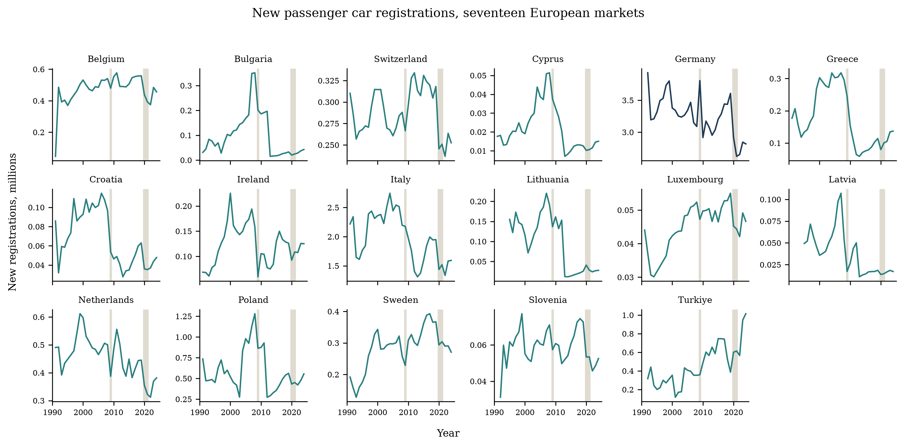
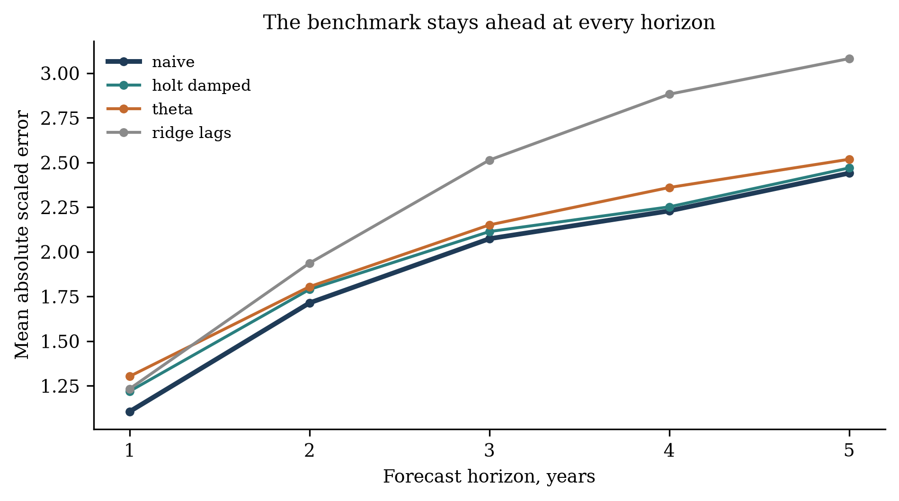
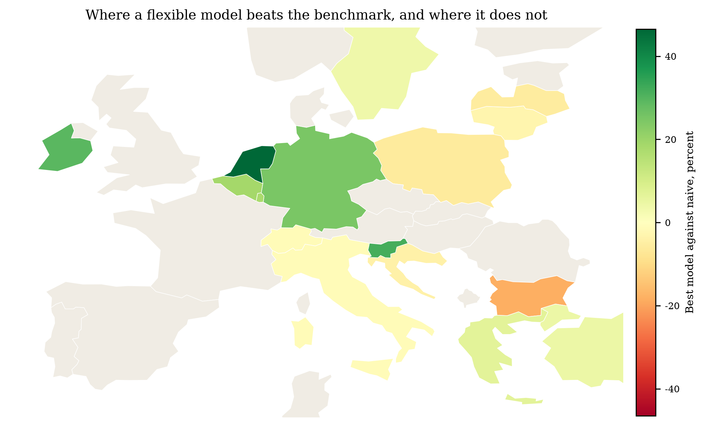
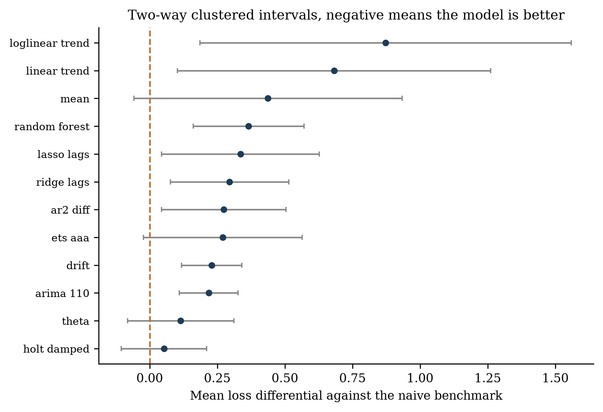
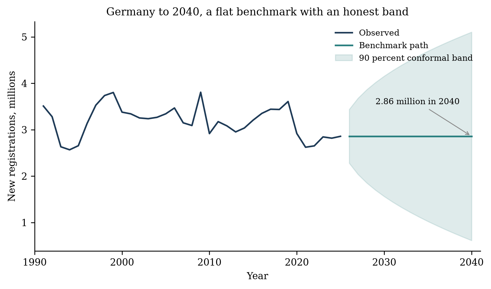

# The benchmark is hard to beat: a time-stamped panel protocol with a machine-checked split for long-horizon car demand

Armin Kajevic

ORCID 0009-0004-1241-8313

Correspondence: armin.kajevic@proton.me

Version 2.0, 25 November 2026

Concept DOI 10.5281/zenodo.24516636

## Abstract

Forecast comparisons in the automotive literature are often run on one market and a short evaluation window. This paper asks whether the winner of such a comparison survives when the same protocol is applied to many markets. The protocol fixes the sample, thirteen candidate models, the tuning rules, the scaled loss, the rolling origins, the tests and the interval construction before the panel is evaluated, and the protocol file carries an external cryptographic timestamp. Two deviations adopted after the first execution, the divergence rule and the ARIMA correction, are labelled post hoc in Section 3.9 and their effect on the sample is reported. The panel covers seventeen European markets from 1991 to 2024, 539 annual observations, 216 forecast origins and 13,610 usable forecast errors. The naive benchmark wins at every horizon, with a mean absolute scaled error of 1.913 against 1.969 for damped Holt and 2.028 for the theta method. No candidate is significantly better after Holm correction, and three are significantly worse. The earlier single-market version, run on Germany alone, had reported a 19.5 percent gain for a flexible model over the same benchmark. Re-estimated with the same model set, the German winner gains 18.5 percent; on the panel that model is 5.3 percent worse than the benchmark, and the rank correlation between the two evaluations is 0.41. A Monte Carlo study shows why the usual test overstates precision: with a common annual shock, an independent t test rejects a true null in 64 percent of samples and one-way country clustering still rejects in 16 percent, while two-way clustering by country and year holds the size between 3.7 and 4.7 percent. Split conformal intervals calibrated on the first sixty percent of origins cover at least their nominal level at every horizon. The German projection for 2040 is 2.86 million registrations with a 90 percent band from 0.61 to 5.10 million, four times wider than the 95 percent band in the single-market version. A Lean 4 module proves that the forecast and the scale at an origin depend only on data up to that origin, that any forecaster receiving only the prefix is causal, and that the key order used to break ties in selection has a unique minimum when scores differ. The lesson is uncomfortable and useful: in this class of annual demand series the benchmark is hard to beat, single-market wins are fragile, and a corridor honest enough for planning is much wider than the published one.

Keywords: forecast evaluation, rolling origin, pre-registration, conformal prediction, panel data, automotive demand

JEL: C12, C32, C52, C53, L62

## 1 Introduction

A forecast comparison looks like a measurement. A set of models is fitted to the same history, each is asked for the same future values, and the model with the smallest average error is declared the winner. The appearance of measurement hides a large number of choices: which models enter, how their parameters are tuned, which loss is reported, which origins are evaluated, and which of the many possible comparisons are shown. When those choices are made after the results are known, the winner is partly a property of the analyst. The forecasting literature has documented the problem for decades, and the reproducibility literature has shown how persistent it is in applied fields.

This paper does two things. It writes the choices down before the evaluation, and it asks whether the resulting winner travels. The first part is a protocol: a fixed sample, a fixed set of thirteen models, fixed tuning rules that use only the training window, a fixed loss, fixed origins, fixed tests and a fixed interval construction. The protocol file is frozen and sent to an independent time-stamp authority, which returns a signed token that binds the file to a calendar date. The token can be verified with a single command by anyone who has the file. This is a weaker instrument than a registered report, because no journal has reviewed the plan, and it is a stronger instrument than a file in a repository, because the date does not depend on the author.

The second part is the empirical question. The first version of this study evaluated thirteen models on German registrations from 1991 to 2025 and found that a flexible model beat the naive benchmark by about 19 percent. That result was internally consistent, statistically tested and reproducible from the repository. It was also, as the panel shows, a property of one market. When the same exercise is repeated on seventeen European markets, the benchmark wins at every horizon, the German winner falls to fourth place, and the correlation between the two rankings is weak. The gain does not survive the change of sample.

That finding is the contribution. It is not a claim that flexible models are useless. It is a demonstration that a single-market rolling-origin comparison, even when it is carefully executed, has enough sampling variation to produce a large and statistically significant improvement that does not generalize. The panel makes the variation visible, and the Monte Carlo study shows that the conventional test makes it worse by understating the standard error when errors share a common annual shock.

The paper also repairs the interval. The single-market version reported a 2040 interval from 2.56 to 3.69 million registrations, calibrated on errors at horizons of one to five years and applied to a horizon of fifteen. The panel allows a split conformal calibration by horizon, a check of empirical coverage on held-out origins, and an explicit scaling rule beyond the evaluated horizon. The resulting band is much wider, and the paper argues that the wider band is the correct one. A planning department that uses a corridor of plus or minus four hundred thousand vehicles at a fifteen-year horizon is using a corridor that the data do not support.

The formal part is strengthened as well. The first version proved that the indices used by the training window lie below the origin, a statement that is true and nearly trivial. The new module proves a property of the functions: the forecast and the scale at an origin are invariant to any change in the data after that origin, and the lexicographic key order used to break ties is a total order whose fold returns a unique minimum when scores differ. The module does not verify the statistical tests, and the Python implementation is a specification of the same rule rather than code extracted from Lean. The Lean 4 kernel checks the proofs, the module contains no unfinished proof, and the axioms it relies on are the three standard ones.

The paper proceeds as follows. Section 2 reviews the literature on forecast evaluation, multiplicity, reproducibility and formal verification. Section 3 states the protocol, including the models, the loss, the tests and the interval rule, and describes the time stamp and the two deviations that occurred during execution. Section 4 describes the panel and its breaks. Section 5 reports the panel results. Section 6 compares the single-market and panel evaluations and explains why the ranking does not travel. Section 7 reports the Monte Carlo study and the robustness checks. Section 8 builds the 2040 corridor. Section 9 describes the Lean module. Section 10 discusses implications and limitations, and Section 11 concludes.

## 2 Literature review

### 2.1 Evaluation on a rolling origin

The practice of evaluating a forecast on a sequence of origins goes back to the forecast competitions and to the early work on out-of-sample comparison. Tashman (2000) gave the canonical statement of the rolling-origin design and warned that a single holdout split wastes information and produces tests with low power. The M competitions turned the design into a shared benchmark: Makridakis and Hibon (2000) reported the third competition and Makridakis, Spiliotis and Assimakopoulos (2020) the fourth, where combinations and simple benchmarks again performed well against elaborate methods. The recurring result is that the naive forecast is a serious competitor on annual and short-horizon data, and that the marginal value of complexity is small.

The econometric literature added inference. Diebold and Mariano (1995) proposed a test of equal expected loss based on the loss differential, Harvey, Leybourne and Newbold (1997) corrected its small-sample behaviour for multi-step forecasts, and Clark and West (2007) handled the nested-model case in which the larger model is true under the null. Giacomini and White (2006) shifted the object from the model to the forecasting method and proposed a conditional test that can detect state dependence in relative performance. These tests share an assumption that matters here: the loss differentials are stationary and weakly dependent, so a heteroskedasticity and autocorrelation consistent variance is adequate. That assumption is doubtful when the evaluation covers many units observed in the same years, because a common shock enters every country in the same period. The econometric literature on multiway clustering, summarised by Cameron, Gelbach and Miller (2011), shows that one-way clustering understates the variance in exactly this configuration, and Section 7 quantifies the consequence.

### 2.2 Loss, scale and the object

The choice of loss is not neutral. Hyndman and Koehler (2006) reviewed the measures used in practice and recommended the mean absolute scaled error because it is scale free, defined at zero and comparable across series. The scale is usually the mean absolute error of the naive forecast in the training window, which makes the loss a ratio of two average errors. The ratio is bounded below by zero and has no upper bound, so a single divergent forecast can dominate an average; this is why the protocol defines a divergence rule and reports the affected cells rather than letting them enter the mean.

Probabilistic evaluation is a separate object. Gneiting and Katzfuss (2014) set out the properties that a scoring rule should have, and the interval literature has moved from residual quantiles to calibration and coverage. The split conformal approach of Vovk, Gammerman and Shafer (2005) gives a distribution-free finite-sample guarantee under exchangeability, which annual time series do not satisfy exactly. The paper therefore uses conformal quantiles as a calibration device and checks their empirical coverage on held-out origins rather than claiming a guarantee.

### 2.3 Testing equal accuracy

Three practical issues arise in a panel of this kind. The first is the dependence structure, discussed above. The second is multiplicity: thirteen models against one benchmark produce twelve comparisons, and the probability of at least one false positive grows quickly. The Holm procedure controls the familywise error rate without assuming independence and is the appropriate default when the family is small and fixed in advance. The third is the distinction between testing a specific null and selecting a set of good models. Hansen, Lunde and Nason (2011) proposed the model confidence set, which inverts a sequence of tests to produce a set that contains the best model with a stated probability. The set is informative when the sample can separate the candidates and uninformative when it cannot. Section 5 reports both objects and interprets the difference.

### 2.4 Multiplicity, forking paths and pre-registration

The credibility revolution in economics and psychology produced a large literature on specification search. Simmons, Nelson and Simonsohn (2011) showed how flexible analysis choices inflate false positives, Gelman and Loken (2014) generalised the point to the garden of forking paths, and Christensen and Miguel (2018) reviewed the evidence in economics and the remedies that journals adopted. Nosek, Ebersole, DeHaven and Mellor (2018) argued that preregistration shifts the inferential weight from the result to the plan, Munafò and colleagues (2017) made the same case for reproducibility across disciplines, and Peng (2011) stated the computational version of the norm.

Forecasting has adopted these ideas unevenly. The M competitions publish their protocols and some journals encourage registered reports, but a forecast comparison with a frozen protocol and an external timestamp is still unusual. This paper does not claim that a timestamp is equivalent to peer review of the plan. It claims something narrower and verifiable: the file that contains the sample, the models, the tuning rules, the loss, the tests and the interval rule existed in that exact form at a date recorded by a third party, before the panel was evaluated.

### 2.5 Reproducibility and formal verification

Reproducibility is a property of a pipeline, and formal verification is a property of a statement. The two are complementary: a reproducible pipeline can contain a logical error, and a verified theorem can be irrelevant to the code that produced the numbers. The Lean 4 system, described by de Moura and Ullrich (2021) and supported by the mathematical library of the mathlib Community (2020), allows a small core of definitions to be checked down to the axioms. The first version of this paper used Lean to prove that the indices of the training window lie below the origin, which was true and added little because the code already sliced the array. The present version proves a property of the functions: the forecast and the scale at an origin are invariant to changes in the data after the origin.

### 2.6 Machine learning and the benchmark

The machine learning literature on time series has produced many flexible predictors and fewer careful evaluations. Breiman (2001) introduced the random forest, Friedman (2001) the gradient boosting machine, and Hoerl and Kennard (1970) the ridge estimator used here as a regularised autoregression. Bergmeir and Benítez (2012) and Bergmeir, Hyndman and Koo (2018) examined when cross-validation is valid for time series and concluded that it is defensible when the folds respect the temporal order and the errors are not strongly dependent; the protocol uses time series cross-validation inside each training window for that reason. The empirical record is sober. Cerqueira, Torgo and Mozetič (2020) compared performance estimation methods across many series and found that the choice of evaluation design can change the ranking more than the choice of model. That result motivates the present design, in which the design is the object of study and the models are the variation it is asked to handle.

### 2.7 Automotive demand and the case for a corridor

The automotive literature on demand has focused on the determinants of registrations and on the transition to electric vehicles. Klier and Rubenstein (2008) described the structure of the North American supply chain, Sturgeon, Van Biesebroeck and Gereffi (2008) analysed the global value chain and its regional clusters, and the International Energy Agency (2025) documents the pace of electrification. Industry sources publish annual registrations: the European Automobile Manufacturers Association (2025) for Europe, Destatis (2026) for Germany, and the China Association of Automobile Manufacturers (2025) for China.

Planning departments use these series to size capacity, employment and investment, and a point forecast is of limited use for decisions with long lead times and asymmetric costs. What they need is a corridor: a range that contains the future with a stated probability, narrow enough to be informative and wide enough to be credible. The panel shows that the data support a corridor about four times wider than the one the single-market version reported, and the difference changes the decision that the corridor can support.

### 2.8 The gap

Three gaps follow. A forecast comparison run on one market cannot report whether its ranking survives a change of sample. The standard errors rarely account for the common shock that affects all units in the same year. The intervals reported for long horizons are calibrated on short horizons and are not checked for coverage. This paper addresses all three: it runs a frozen protocol on seventeen markets, compares the panel ranking with the single-market ranking, and calibrates intervals by horizon with a coverage check and an explicit extrapolation rule.

## 3 Protocol

### 3.1 Objects and the non-anticipative condition

Let $y_{c,t}$ be the number of new passenger car registrations in country $c$ in year $t$. A forecast origin is a pair $(c,m)$, where $m$ is the last year whose value is used. The training window is

$$ \mathcal{T}_{c,m} = \{t \le m : y_{c,t} \text{ observed}\}. $$

A forecasting method is a map $f$ that receives the training window and a horizon $h$ and returns $\hat{y}_{c,m+h|m} = f(\mathcal{T}_{c,m}, h)$. The non-anticipative condition is

$$ f(\mathcal{T}_{c,m}, h) = f(\mathcal{T}_{c,m} \cup \{y_{c,s} : s > m\}, h) \quad \text{for every } h, $$

that is, the forecast does not change when data after the origin are added to the input. The condition is stated over the function, not over the index of a loop, and Section 9 proves it in Lean for the mean forecast and for the scale used by the loss.

### 3.2 Loss and scaled loss

The primary loss is the mean absolute scaled error of Hyndman and Koehler (2006). For a forecast at origin $m$ and horizon $h$,

$$ e_{c,m,h} = y_{c,m+h} - \hat{y}_{c,m+h|m}, \qquad q_{c,m,h} = \frac{|e_{c,m,h}|}{s_{c,m}}, $$

where the scale is the mean absolute first difference of the training window,

$$ s_{c,m} = \frac{1}{|\mathcal{T}_{c,m}|-1} \sum_{t \in \mathcal{T}_{c,m}, t > \min \mathcal{T}_{c,m}} |y_{c,t} - y_{c,t-1}|. $$

If the scale is zero, which happens only for a constant training window, the mean absolute level is used instead. The loss is scale free, so a small market and a large market contribute comparable numbers. The secondary losses are the symmetric mean absolute percentage error and the ratio of the mean absolute error to the naive mean absolute error; both are reported in the appendix.

Aggregation gives each country equal weight and each origin equal weight within a country:

$$ \bar{q}_{f} = \frac{1}{C} \sum_{c=1}^{C} \frac{1}{O_c} \sum_{m \in \mathcal{O}_c} \frac{1}{H} \sum_{h=1}^{H} q_{c,m,h}(f). $$

The equal weighting is a choice, and it matters. A pooled average over all errors would give more weight to countries with long histories. The protocol fixes the country as the unit of analysis, so the country average comes first and the cross-country average second.

### 3.3 The selection functional

The protocol does not select a model by taking the minimum of a noisy average without inference. It reports three objects. The first is the ranking by $\bar{q}_f$. The second is the family of twelve loss differentials against the benchmark,

$$ d_{c,m,h}(f) = q_{c,m,h}(f) - q_{c,m,h}(\text{naive}), $$

with a two-way clustered standard error and a Holm adjustment over the twelve comparisons. The third is the model confidence set of Hansen, Lunde and Nason (2011) at ninety percent, computed on the country-level mean losses with a studentised range and a country bootstrap. The three objects answer different questions: which model has the smallest average loss, which differences are distinguishable from zero, and which models cannot be excluded from the set of best models.

### 3.4 The candidate set

Thirteen candidates enter. They span the range from a random walk to a regularised machine learning model, and they are fixed in the protocol before the panel is evaluated.

Table 1. The thirteen candidates, their tuning and their inputs.

| Candidate | Family | Tuning inside the training window | Inputs |
|:--|:--|:--|:--|
| naive | benchmark | none | last value |
| mean | benchmark | none | training mean |
| drift | trend | none | first and last value |
| linear trend | trend | none | time index |
| log-linear trend | trend | none | log level and time index |
| damped Holt | exponential smoothing | grid over alpha, beta, phi | level and trend |
| ETS(A,A,N) | exponential smoothing | maximum likelihood | level and trend |
| ARIMA(1,1,0) | autoregression | maximum likelihood | lagged differences |
| AR(2) on differences | autoregression | least squares | two lagged differences |
| ridge on lags | regularised regression | penalty by time series cross-validation | three lagged differences |
| lasso on lags | regularised regression | penalty by time series cross-validation | three lagged differences |
| random forest | machine learning | fixed, 300 trees, depth 3 | three lagged differences |
| theta | decomposition | smoothing constant | theta line and trend |

The damped Holt model follows Gardner and McKenzie (1985), the theta method Assimakopoulos and Nikolopoulos (2000), the lasso Tibshirani (1996), and the ETS specification Hyndman, Koehler, Snyder and Grose (2002).

Two rules apply to every candidate. No parameter is estimated on data dated at or after the origin, and no hyperparameter is selected on the evaluation window. The damped Holt grid, the ridge and lasso penalties and the smoothing constant of the theta method are chosen inside the training window, by in-sample fit or by time series cross-validation with folds that respect the order of the data. The random forest is not tuned at all; its depth and leaf size are fixed in the protocol.

### 3.5 Origins, horizons and windows

The training window expands. At origin $m$ it contains every observed year up to $m$, and the minimum length is fifteen observations. The maximum horizon is five years. An origin enters the evaluation only if five future values are observed, so the last origin is 2019 for a series that ends in 2024. The panel produces 216 origins across seventeen countries, and each origin contributes five forecast errors per model, which gives 1,080 errors per model before the divergence rule and 13,610 usable errors across all models after it.

The expanding window is a choice. A rolling window of twenty years is reported as a robustness check in Section 7, together with the exclusion of the crisis origins of 2009 and 2020 to 2021.

### 3.6 The divergence rule

A scaled loss has no upper bound. A recursive model that feeds its own forecast back into its lag structure can produce a path that grows without limit, and one such path can dominate an average of more than a thousand errors. The protocol therefore classifies a path as divergent when any of its five values is non-positive or exceeds ten times the maximum of its training window. Divergent paths are counted, reported by model and by country, and excluded from the aggregate loss. They are never replaced by another model's forecast.

The rule was added after the first execution of the panel script, when one recursive specification produced explosive paths in small markets. It is reported here as a deviation, with the counts in Section 6, because a rule that removes observations has to be visible.

### 3.7 Tests

The primary test is a two-sided Diebold-Mariano statistic on the pooled loss differential of each candidate against the benchmark, with a two-way clustered variance:

$$ \hat{V} = \hat{V}_{\text{country}} + \hat{V}_{\text{year}} - \hat{V}_{\text{cell}}, $$

where each component is the cluster-robust variance of the mean differential along that dimension and the third term removes the double counting, following Cameron, Gelbach and Miller (2011). The statistic is referred to a t distribution with degrees of freedom equal to the smaller of the two dimensions minus one, which is fourteen in this panel. The Holm procedure is applied over the twelve comparisons at a familywise level of 0.05.

Three secondary tests are reported. The first is the Harvey-Leybourne-Newbold version of the Diebold-Mariano test at each horizon, applied to the series of cross-country mean differentials. The second is the Giacomini-White conditional test, which regresses the differential on its lag and tests the slope with a heteroskedasticity and autocorrelation consistent variance. The third is the model confidence set described above. Section 7 reports a Monte Carlo study of the size of the first-stage tests, because the choice of variance estimator is the most consequential decision in the whole design.

### 3.8 Intervals

Intervals are built by split conformal prediction, separately for each horizon. For a candidate $f$, the nonconformity score of an evaluation cell is the scaled absolute error $q_{c,m,h}(f)$. Within each country, the first sixty percent of origins form the calibration set and the remaining forty percent form the evaluation set. For a target level $1-\alpha$, the quantile is

$$ \hat{q}_{h} = \text{the } \left\lceil \frac{(n_h+1)(1-\alpha)}{n_h} \right\rceil \text{-th smallest score}, $$

with $n_h$ the number of calibration scores at horizon $h$. The interval for a forecast in levels is $\hat{y} \pm \hat{q}_h s_{c,m}$. Empirical coverage is the share of evaluation scores that fall below $\hat{q}_h$, and it is reported for the levels 0.80, 0.90 and 0.95.

Beyond the evaluated horizon of five years, the protocol extrapolates the five-year quantile by the square root of $h/5$. The rule is the one implied by a random walk, in which the variance of the error grows linearly in the horizon. It is an assumption, it is labelled as one, and the paper does not present the resulting band as a guarantee.

### 3.9 The timestamp and the two deviations

The protocol file `protocol/p01_protocol.yaml` has SHA256 digest `ab84f048607551395a6d23d9e07309228bbfefc7c4cd3e83b326a64e38ed708a`. On 25 November 2026 at 10:04:45 GMT, the Free TSA time-stamp authority returned a signed token with serial number 0x0A90D1DF, binding that digest to that date; the format is the one defined in RFC 3161 (Internet Engineering Task Force 2001). The token, the authority certificate and the root certificate are stored next to the protocol file. Verification requires one command:

```
openssl ts -verify -data protocol/p01_protocol.yaml \
  -in protocol/p01_protocol.tsr \
  -CAfile protocol/tsa_cacert.pem -untrusted protocol/tsa.crt
```

Two deviations occurred, and both are post hoc in the strict sense: neither appears in the timestamped protocol file, and both were adopted after the first execution. The first is the divergence rule of Section 3.6, added when one recursive specification produced explosive paths in small markets. The second concerns the ARIMA model: the first execution specified a constant in levels, which is not identified when the series is differenced once, and the model silently fell back to drift for every origin. The specification was corrected to a constant in the differenced equation, the panel was rerun, and no other model changed. Both deviations are recorded in the repository with their dates, and neither changes the ranking at the top: the benchmark leads in both executions.

The single-market results of Section 6 are not covered by the timestamp. They were produced before the protocol was frozen and are reported as stage one, with the date of the earlier version. The timestamp covers the panel evaluation, which had not been run when the token was issued.

## 4 Data

### 4.1 The panel

The panel is the Eurostat dataset `road_eqr_carmot`, new passenger cars by type of motor energy and engine size, annual, total motor energy and total engine size. The raw response is cached unchanged, with SHA256 digest `27c1edcd49c013e2babdfc6e8798f212bbd65f316281a3ddf06ec86acfe7e91a`, and parsed into a country-year table. Aggregates such as the European Union and the euro area are removed, because they are sums of the country series. A country enters the sample when it has at least twenty-five consecutive annual observations ending in 2024 inside the window from 1991 to 2024. Seventeen countries qualify: Belgium, Bulgaria, Cyprus, Germany, Greece, Croatia, Ireland, Italy, Lithuania, Luxembourg, Latvia, the Netherlands, Poland, Sweden, Slovenia, Switzerland and Türkiye.

The rule excludes the large markets of France, Spain and the United Kingdom, which have gaps in this dataset. That is a cost. The benefit is a sample in which every country contributes a continuous history and no interpolation is needed. The excluded markets are not replaced by other sources, because mixing sources would introduce a definitional break that the protocol cannot control. Section 10 discusses the consequence for external validity.

Table 2. The seventeen countries, their first year in the sample and their number of origins.

| Country | Code | First year | Observations | Origins |
|:--|:--|--:|--:|--:|
| Belgium | BE | 1998 | 27 | 8 |
| Bulgaria | BG | 1991 | 34 | 15 |
| Switzerland | CH | 1991 | 34 | 15 |
| Cyprus | CY | 1991 | 34 | 15 |
| Germany | DE | 1992 | 33 | 14 |
| Greece | EL | 1991 | 34 | 15 |
| Croatia | HR | 1991 | 34 | 15 |
| Ireland | IE | 1991 | 34 | 15 |
| Italy | IT | 1991 | 34 | 15 |
| Lithuania | LT | 1995 | 30 | 11 |
| Luxembourg | LU | 1998 | 27 | 8 |
| Latvia | LV | 1995 | 30 | 11 |
| Netherlands | NL | 1997 | 28 | 9 |
| Poland | PL | 1991 | 34 | 15 |
| Sweden | SE | 1991 | 34 | 15 |
| Slovenia | SI | 1992 | 33 | 14 |
| Türkiye | TR | 2000 | 25 | 6 |

The seventeen series differ in level by more than an order of magnitude, from about ten thousand registrations a year in Luxembourg to more than three million in Germany. The scaled loss makes them comparable. Figure 1 shows the series with the two crisis windows shaded.



### 4.2 Breaks and shocks

Three events dominate the variance. The 2008 to 2009 financial crisis produced double-digit declines in most markets, with scrappage schemes that pulled purchases forward and created a rebound in 2010. The 2020 pandemic closed dealerships for part of the year, and the 2021 to 2022 semiconductor shortage constrained supply after demand had recovered. A model that is evaluated across these events is being asked to forecast a series with large common shocks, which is precisely the configuration in which the standard test understates uncertainty.

The protocol does not remove the crisis years from the primary evaluation, because a forecast comparison that excludes the hard years is not a forecast comparison. It reports a robustness check without them. The check matters for the interpretation: if the ranking is stable with and without the crises, the conclusion does not depend on three observations per country.

### 4.3 The German case and the Chinese control

Two series outside the panel are used. The German series from Destatis runs from 1991 to 2025 and serves two purposes: it is the sample of the single-market stage, and it is the origin of the 2040 projection. Its 2025 value is 2,857,591 registrations.

The Chinese series is the Volkswagen Group's annual deliveries in China. It is used as a held-out negative control: a series with structural breaks, a reporting change and a missing year, on which the protocol is expected to struggle. A method that wins on the panel and also wins on the control would be suspicious, because the control was chosen to violate the stationarity assumption that the panel approximately satisfies.

## 5 Results

### 5.1 The ranking

Table 3 reports the mean scaled error of each candidate over the panel, with the difference from the benchmark in percent. The benchmark is first. Damped Holt is second, 2.9 percent worse, and the theta method is third, 6.0 percent worse. The remaining ten candidates are between 18 and 46 percent worse than a forecast that repeats the last observed value.

Table 3. Mean absolute scaled error over the panel, by candidate.

| Rank | Candidate | Mean scaled error | Difference from naive, percent |
|--:|:--|--:|--:|
| 1 | naive | 1.913 | 0.0 |
| 2 | damped Holt | 1.969 | 2.9 |
| 3 | theta | 2.028 | 6.0 |
| 4 | ARIMA(1,1,0) | 2.257 | 18.0 |
| 5 | drift | 2.258 | 18.0 |
| 6 | ETS(A,A,N) | 2.308 | 20.6 |
| 7 | AR(2) on differences | 2.318 | 21.2 |
| 8 | ridge on lags | 2.330 | 21.8 |
| 9 | mean | 2.350 | 22.9 |
| 10 | lasso on lags | 2.392 | 25.0 |
| 11 | random forest | 2.458 | 28.5 |
| 12 | linear trend | 2.595 | 35.6 |
| 13 | log-linear trend | 2.785 | 45.6 |

The ordering is stable across horizons. Figure 2 plots the four leading candidates by horizon. The benchmark is lowest at every horizon, and the gap narrows with the horizon: damped Holt is 10.3 percent worse at one year and 1.2 percent worse at five, while the theta method is 17.8 percent worse at one year and 3.2 percent worse at five. The ordering never reverses, and the narrowing is the reason the long-horizon comparison is the harder test for a challenger.



The ranking does not depend on the weighting at the top. A pooled average over all errors, which gives more weight to countries with long histories, leaves the first three places unchanged and permutes only the middle of the table. The equal-country mean is the statistic that the protocol fixes, and it is the one reported throughout.

### 5.2 Inference

Table 4 reports the loss differential of each candidate against the benchmark, with the two-way clustered standard error, the confidence interval, the t statistic, the p value and the Holm-adjusted p value. Negative values mean that the candidate is better than the benchmark; all point estimates are positive, so no candidate is better.

Table 4. Loss differentials against the naive benchmark, two-way clustered by country and year.

| Candidate | Differential | 95 percent interval | t | p | Holm p |
|:--|--:|:--|--:|--:|--:|
| damped Holt | 0.053 | -0.105 to 0.211 | 0.72 | 0.484 | 0.484 |
| theta | 0.115 | -0.082 to 0.312 | 1.25 | 0.232 | 0.463 |
| ARIMA(1,1,0) | 0.219 | 0.110 to 0.327 | 4.33 | 0.001 | 0.008 |
| drift | 0.229 | 0.118 to 0.341 | 4.40 | 0.001 | 0.007 |
| ETS(A,A,N) | 0.270 | -0.023 to 0.564 | 1.98 | 0.068 | 0.273 |
| AR(2) on differences | 0.274 | 0.044 to 0.504 | 2.56 | 0.023 | 0.160 |
| ridge on lags | 0.296 | 0.076 to 0.515 | 2.89 | 0.012 | 0.106 |
| lasso on lags | 0.336 | 0.044 to 0.628 | 2.47 | 0.027 | 0.160 |
| random forest | 0.366 | 0.162 to 0.570 | 3.84 | 0.002 | 0.018 |
| mean | 0.438 | -0.059 to 0.934 | 1.89 | 0.079 | 0.273 |
| linear trend | 0.682 | 0.102 to 1.261 | 2.52 | 0.024 | 0.160 |
| log-linear trend | 0.873 | 0.186 to 1.559 | 2.73 | 0.016 | 0.131 |

Two candidates are significantly worse than the benchmark after Holm: drift and ARIMA, at 0.007 and 0.008. The random forest is also rejected at 0.018. The remaining differences are not distinguishable from zero at the familywise level. The two closest challengers, damped Holt and theta, have intervals that include zero by a wide margin.

The comparison between the one-way and two-way clustered p values is instructive even where neither rejects. For damped Holt the one-way value is 0.404 and the two-way value is 0.484; for theta the values are 0.128 and 0.232. The two-way standard error is between a sixth and a quarter larger, and the difference grows with the number of years in which the errors move together. Section 7 shows which of the two is right: in a design calibrated to this panel the one-way procedure rejects a true null in 15.9 percent of samples, while the two-way procedure holds the size at 4.7 percent, or 3.7 percent once a country-origin effect is added.

The model confidence set at ninety percent contains all thirteen candidates. With seventeen clusters and a studentised range, the set cannot exclude any model, including the linear trend that is 36 percent worse than the benchmark. That is not a contradiction of Table 4. The pairwise tests ask whether a specific difference is zero, and they have more power against specific alternatives. The confidence set asks whether a model can be excluded from the set of best models, and with seventeen clusters it cannot. The result is a statement about the limits of the sample, and it is reported rather than hidden.

### 5.3 Where the models help and where they hurt

The country-level pattern is heterogeneous. Figure 3 maps, for each country, the percentage by which the best non-naive candidate beats the benchmark. Positive values mean that at least one flexible model improves on the naive forecast in that country; negative values mean that none does.



The dispersion is large. In the Netherlands the best flexible model improves on the benchmark by 46.5 percent, in Slovenia by 31.7, in Ireland by 29.2, in Germany by 24.9, in Belgium by 18.6 and in Luxembourg by 17.5. In Cyprus the best flexible model is 19.3 percent worse than the benchmark, in Bulgaria 18.3 percent worse, and in Poland, Latvia, Croatia, Lithuania, Switzerland and Italy between 1.4 and 6.1 percent worse. Greece, Türkiye and Sweden sit close to zero on the positive side. The map is the visual form of the paper's argument: the value of a flexible model is a property of the market and the period, not of the model alone. A study that samples one country can land on either side of zero.

The forest plot in Figure 4 shows the same heterogeneity in the inferential metric. Each point is a mean differential against the benchmark, and each bar is a two-way clustered interval. The intervals are wide, they overlap, and the two closest challengers cannot be separated from zero.



### 5.4 The Chinese stress case

On the Chinese deliveries series no candidate beats the benchmark. The scaled error of the naive forecast is 7.78, which is large in absolute terms because the series contains a structural break and a missing year, and the scaled errors of the flexible candidates are between 8 and 15. The result is a stress case, not a held-out control: the series was already analysed in the first version, so it cannot test the protocol out of sample, but it shows that the protocol does not manufacture a winner where the data contain none. The large scale is itself informative. It says that the naive scale, computed on a series with a break, is a poor normaliser, and it is the reason the paper reports the scaled loss alongside the unscaled error in the appendix.

## 6 The single-market illusion

### 6.1 What the first version found

The first version of this study evaluated thirteen models on German registrations from 1991 to 2025, with origins from 2006 to 2020, horizons from one to five years and the same scaled loss. It reported that a flexible model beat the naive benchmark by about 19 percent, that the improvement grew with the horizon, and that the result survived a battery of robustness checks. The finding was internally consistent: the model was estimated only on training data, the loss was scale free, and the test was corrected for the overlap induced by multi-step forecasts.

The first version also reported a 2040 projection of 3.16 million registrations with a ninety-five percent interval from 2.56 to 3.69 million. The interval was calibrated on errors at horizons of one to five years and applied to a horizon of fifteen. That extrapolation was the weakest part of the paper, and the panel makes the weakness visible.

### 6.2 The same models on two samples

To compare like with like, the model set of the first version was re-estimated on both samples with the specifications written in that version: thirteen candidates including an autoregression on levels, an autoregression on growth rates, a six-feature ridge with a fixed penalty, a gradient boosting machine and an equal-weight combination. Table 5 reports the mean scaled error on Germany and on the panel, the two ranks and the share of divergent paths.

Table 5. The first-version model set on Germany and on the panel.

| Candidate | Germany | Rank | Panel | Rank | Divergent, percent |
|:--|--:|--:|--:|--:|--:|
| AR(1) on levels | 1.292 | 1 | 2.014 | 4 | 0.0 |
| ridge on three lags | 1.360 | 2 | 2.372 | 8 | 0.9 |
| random forest | 1.509 | 3 | 2.004 | 3 | 0.0 |
| six-feature ridge | 1.549 | 4 | 2.557 | 10 | 5.6 |
| combination | 1.582 | 5 | 2.185 | 5 | 0.5 |
| naive | 1.585 | 6 | 1.913 | 1 | 0.0 |
| ARIMA(1,1,1) | 1.592 | 7 | 2.256 | 6 | 5.1 |
| log-linear trend | 1.637 | 8 | 2.785 | 13 | 0.0 |
| damped Holt | 1.646 | 9 | 2.385 | 9 | 0.9 |
| gradient boosting | 1.649 | 10 | 2.002 | 2 | 0.0 |
| drift | 1.655 | 11 | 2.258 | 7 | 3.2 |
| AR(1) on growth | 1.946 | 12 | 2.717 | 11 | 0.0 |
| Holt | 2.065 | 13 | 2.774 | 12 | 6.5 |

The published first-version winner was the ridge on lagged growth at 1.284, not the autoregression. The re-implementation gives the ridge 1.360 and moves the autoregression to first, so the exact tuning of the first version is not reproduced and the comparison that follows uses the winner of the re-estimated set. The ridge that won the published comparison is 24 percent worse than the benchmark on the panel in the re-estimation, so the sign of the result does not depend on which of the two is used. On Germany, the autoregression on levels beats the benchmark by 18.5 percent and the benchmark ranks sixth. On the panel, the same model is fourth, 5.3 percent worse than the benchmark, and the benchmark is first. The rank correlation between the two evaluations is 0.41, with a p value of 0.16; the two rankings are not statistically distinguishable from unrelated orderings. The six-feature ridge falls from fourth to tenth and diverges in 5.6 percent of its paths.

The divergence pattern is informative. The models that feed forecasts back into their own lag structure, the six-feature ridge, the ARIMA(1,1,1), the Holt and the drift, produce explosive paths in small markets where the level is close to zero relative to its historical variation. The models that predict a transformation and invert it, or that average several forecasts, do not. The first version could not see this because it evaluated one large and stable market.

### 6.3 Why the ranking does not travel

Three mechanisms explain the gap. Sampling variation comes first: fifteen origins and five horizons give 75 errors per model, and the standard error of a mean scaled error of about 1.5 is large enough to move a model several ranks, while the panel multiplies the origins by fourteen. The second is the common shock: in a single market a model that happens to fit 2009 and 2020 looks better than it is, because those observations carry a large share of the variance, and in a panel the same shock appears in every country. The third is the interaction between model and market: a linear trend is a good forecast for a market converging to a stable level and a bad one for a market that is cycling. A single-market study estimates that interaction for one market and reports it as a property of the model.

None of this is exotic, and together the mechanisms imply that a single-market comparison is a weak instrument for model selection. The panel does not prove that flexible models are useless; it shows that the evidence for their value is weaker than a single-market backtest suggests.

### 6.4 What survives

One result survives the change of sample: the benchmark is hard to beat. The damped Holt model is a close second in the protocol set, 2.9 percent worse on the panel and second at every horizon, but it ranks ninth in the first-version set on both samples. Its promotion is therefore a property of the protocol set, not a finding that is stable across specifications. The one positive statement about a flexible model that the paper can defend is narrower: damped Holt is the only challenger that comes within three percent of the benchmark in the protocol set, and it does so at every horizon.

The negative findings are stronger. A linear trend, a log-linear trend, a random forest and a six-feature ridge are all worse than the benchmark on the panel in point estimate. Only the random forest is significantly worse after Holm correction. The linear trend (p = 0.160) and the log-linear trend (p = 0.131) do not pass the corrected threshold, and the six-feature ridge is not part of the protocol set, so it has no Holm-adjusted p value to report. The distinction matters: the paper can say that the flexible models do not beat the benchmark, not that every one of them is significantly worse.

## 7 Monte Carlo and robustness

### 7.1 Why a simulation

The tests in Section 5 rest on a variance estimator, not on a known sampling distribution. With seventeen countries and fourteen origin years the asymptotic justification of the two-way cluster variance is plausible but not guaranteed, and the one-way alternative is used widely enough that its finite-sample behaviour matters. The simulation asks a narrow question. If the true expected loss of two models is equal, how often does each test reject at the five percent level when the loss differential contains a country effect, a year effect and an idiosyncratic cell effect? And if one model is better by a small margin, how often does the test detect it? The answer does not depend on the thirteen forecasting models; it depends only on the dependence structure that the panel exhibits.

### 7.2 Design

The differential is generated as d = mu + a + b + e, where a is a country effect, b an origin effect and e a cell effect, each normal with mean zero and independent of the others. The three standard deviations are estimated from the observed differentials of the twelve challengers against the naive benchmark by the method of moments for a crossed random effects model, and the median across the twelve models is used. 0.312 for the country component, 0.300 for the origin component and 0.829 for the cell component. The components come from the same panel to which the tests are applied, so the exercise is a calibration of the dependence structure rather than an out of sample validation of the loss level. A second design adds a country-origin effect g, shared by the five horizons of the same origin and not captured by clustering on the two margins separately. Its estimated standard deviation is 0.516, and the remaining cell component is 0.596; the two replace the single cell component of the additive design. The design has seventeen countries, fourteen origins and five horizons, which gives 1,190 cells per replication, and 4,000 replications per scenario. The seed is fixed and the script is in the repository.

Five statistics are computed on the same simulated differentials. The first is the independent t test on all cells. The second clusters by country. The third clusters by country and by origin, with the usual subtraction of the cell variance. The fourth is a country block bootstrap with 400 draws. The fifth is the Harvey-Leybourne-Newbold correction at horizon five applied to the series of origin means. Size is measured with mu equal to zero; power with mu equal to minus 0.10, which is a tenth of a point of scaled error, about five percent of the benchmark. The alternative is not arbitrary: the gap between the benchmark and damped Holt is 0.056 and the gap between the benchmark and theta is 0.115, so 0.10 is the range that decides the top of the table.

Table 6. Size and power of the five tests, 4,000 replications, two designs.

| Test | Size, additive | Size, interaction | Power, additive | Power, interaction |
|:--|--:|--:|--:|--:|
| Independent t | 0.638 | 0.657 | 0.745 | 0.774 |
| One-way country cluster | 0.159 | 0.140 | 0.290 | 0.276 |
| Two-way country and origin | 0.047 | 0.037 | 0.108 | 0.098 |
| Country block bootstrap | 0.201 | 0.182 | 0.351 | 0.324 |
| HLN at horizon five | 0.592 | 0.563 | 0.670 | 0.679 |

### 7.3 Size

The independent test rejects a true null in 63.8 percent of samples. The failure is not a small-sample curiosity: it is the expected consequence of treating 1,190 correlated cells as independent observations when the year effect alone carries a variance component of 0.09. One-way clustering removes most of the error but not all of it, because it leaves the common annual shock inside the residual; the rejection rate is 15.9 percent, three times the nominal level. The two-way estimator holds the size at 4.7 percent. The bootstrap is better than the independent test but still over-rejects at 20.1 percent, because resampling countries does not reproduce the year effect. The HLN correction, designed for overlapping forecasts from a single series, leaves the cross-sectional dependence untouched and rejects in 59.2 percent of samples.

The second design adds the country-origin effect, which is the dependence that the two-way variance does not model explicitly. The two-way rejection rate falls to 3.7 percent, so the estimator is conservative rather than liberal in the design that is closer to the data. The one-way rate falls to 14.0 percent and the independent rate rises to 65.7 percent; the ranking of the five procedures is unchanged.

The ordering of the five procedures is the paper's justification for the two-way test and for reporting the one-way p values beside it. A reader who is used to clustering by country would still over-reject by a factor of three in this design.

### 7.4 Power

The two-way test detects a true improvement of 0.10 in only 10.8 percent of samples in the additive design and 9.8 percent in the interaction design. The number is low, and it is informative. The panel has seventeen clusters in one dimension and fourteen in the other, and the year component is large; a difference of a tenth of a point is small relative to the sampling error of the country-balanced mean. The failure to reject equal accuracy in Table 4 is therefore not evidence that all thirteen models are equally good. It is evidence that the panel cannot resolve differences of the size that separates most of them. The model confidence set that contains all thirteen candidates should be read in the same way: it is a statement about the resolving power of the sample, not a statement that the linear trend is as good as the benchmark.

The power result also explains why the paper reports point estimates and ranks alongside the tests. A ranking is a description of the sample; a significant difference is a statement about the population. With this design the first is informative and the second is rare, and a paper that reported only the second would say almost nothing.

### 7.5 Five checks fixed before estimation

The protocol lists five checks that change one ingredient each: the origins, the training window, the loss, the countries and the penalty. All five were run after the timestamp and are reported whether or not they support the ranking.

Table 7. Robustness checks against the main ranking.

| Check | What changes | Cells | Naive | Best challenger | Challenger | Naive rank |
|:--|:--|--:|--:|--:|:--|--:|
| Main specification | nothing | 13,610 | 1.913 | 1.969 | damped Holt | 1 |
| Crisis exclusion | origins 2008 and 2009 removed | 12,065 | 1.766 | 1.778 | damped Holt | 1 |
| Rolling window | 20-year window replaces expanding | 8,090 | 1.892 | 1.907 | theta | 1 |
| Symmetric loss | sMAPE replaces scaled absolute error | 13,610 | 0.297 | 0.327 | damped Holt | 1 |
| Leave one country out | one country removed, 17 folds | 17 folds | - | - | - | 1 in 17 |
| Fixed penalty | ridge alpha set to 0.1, 1, 10, no divergence filter | 13,610 | 1.913 | 2.028 | ridge, alpha 10 | 1 |

The table is the robustness statement in one place: the benchmark is first in every check, and the runner-up changes only between damped Holt and theta.

### 7.6 The crisis and the window

The crisis check removes the origins of 2008 and 2009, which are the two origins whose five-year windows contain the financial crisis and the collapse of the German scrappage programme. The benchmark improves from 1.913 to 1.766, which is expected: the crisis years are hard for every model, and removing them lowers the average error of all candidates. Damped Holt improves from 1.969 to 1.778 and comes within 0.7 percent of the benchmark. The gap between the two is now smaller than the standard error of either mean, and the paper does not claim that damped Holt is worse in a statistical sense. It claims only that it does not beat the benchmark, which is what the test in Table 4 says.

The rolling window replaces the expanding window with the last twenty observations. This is the check that most favours flexible models, because a short window adapts to the level shift after 2009 and gives the damped Holt and theta methods a cleaner signal. Theta moves to second place at 1.907, 0.8 percent worse than the benchmark at 1.892, and damped Holt falls to third at 1.945. The benchmark remains first. The exercise also shows why the protocol fixed the expanding window in advance: with a rolling window the ranking of the challengers changes, and a paper that chose the window after seeing the results could have reported either ordering as the main finding.

### 7.7 A loss that does not scale by the training window

The scaled absolute error divides by the mean absolute first difference of the training window. That normaliser is right for comparing series of different volatility, but it is not the only defensible choice, and a critic could argue that the benchmark benefits because the normaliser is computed on the same differences that the naive forecast extrapolates. The symmetric absolute percentage error removes the normaliser and divides each error by the average of the actual and the forecast.

Under this loss the benchmark is first at 0.297, damped Holt second at 0.327 and theta third at 0.330. The random forest, eleventh under the scaled loss, is eighth at 0.374, and the linear trend is twelfth at 0.420. The top three are unchanged, the rank correlation between the two orderings is 0.93, and the only material movement is the random forest, which gains because percentage errors penalise large errors in small markets less. The conclusion does not depend on the loss.

### 7.8 No single country drives the result

The leave-one-country-out check removes each of the seventeen countries in turn and recomputes the full ranking. The benchmark is first in all seventeen folds. The result is stronger than a standard error: it says that there is no single market whose removal produces a challenger ranking, which is what a critic would look for if the benchmark's advantage came from one large or one unusual country. Germany, which carries the largest weight in a pooled average, is not necessary for the result; neither is the Netherlands, which carries the largest gain for a flexible model.

The divergence rule removes a different number of cells from each model, so the means in Table 3 rest on slightly different samples: 1,080 cells for the models that never diverge, 1,070 for damped Holt, 1,045 for drift, 1,035 for the ridge on lags and 995 for ETS. To check that the ranking does not depend on this, every cell in which any model diverges was dropped and the country-balanced mean was recomputed on the remaining 11,960 errors. The order at the top is unchanged: naive 2.219, damped Holt 2.298, theta 2.319. The levels rise because the dropped cells are not a random subset: they are the cells in which a recursive path explodes, and those cells carry large scaled errors for the affected models. The benchmark keeps its lead on the sample that every model can forecast.

The check also answers a question about the sample rule. The rule admits countries with at least twenty-five consecutive observations, and the excluded countries are mostly small markets with short histories. If the result depended on the composition of the seventeen, removing one country at a time would reveal it. It does not.

### 7.9 The penalty of the ridge model

The ridge model tunes its penalty at every origin over a grid from 0.01 to 100 with three expanding folds. That is defensible, but it makes performance depend on a search that is itself estimated. The check fixes the penalty at 0.1, 1 and 10 and refits at every origin without a search.

The fixed-penalty versions produce mean scaled errors of 2.122, 2.103 and 2.028. The best, at a penalty of 10, is 6.0 percent worse than the benchmark and better than the tuned version at 2.330. The tuned ridge is therefore not the best ridge, which is a limitation of the candidate set rather than of the benchmark, and no fixed penalty closes the gap. The protocol did not search over penalties after the fact, because that search on the evaluation sample would be the forking path it is designed to prevent.

## 8 The corridor to 2040

### 8.1 Conformal calibration

The interval is built by split conformal prediction on the origin dimension. The origins are ordered by year, the first sixty percent form the calibration set and the remaining forty percent the evaluation set. For each horizon the calibration set gives the empirical quantile of the absolute scaled error, and the interval is the point forecast plus and minus that quantile times the scale of the training window. The split respects the time order, so calibration errors come from earlier origins than evaluation errors. This is not the exchangeability that the conformal guarantee assumes, and the coverage below is an empirical property of this panel rather than a theorem.

Table 8. Empirical coverage of the split conformal interval, by nominal level and horizon.

| Horizon | 80 percent | 90 percent | 95 percent | Calibration cells | Evaluation cells |
|--:|--:|--:|--:|--:|--:|
| 1 | 0.884 | 0.953 | 0.988 | 130 | 86 |
| 2 | 0.919 | 0.953 | 0.988 | 130 | 86 |
| 3 | 0.907 | 0.942 | 0.953 | 130 | 86 |
| 4 | 0.919 | 0.953 | 1.000 | 130 | 86 |
| 5 | 0.907 | 0.953 | 1.000 | 130 | 86 |

The interval over-covers at every level. At the ninety percent level the empirical coverage is 0.953 at both the first and the fifth horizon; at the eighty percent level it is between 0.884 and 0.919; at the ninety-five percent level it reaches one at horizons four and five. Over-coverage of this size is expected when the quantile is estimated from 130 cells and the evaluation set is small. It is also the conservative direction: a corridor that is too wide is a weaker claim than a corridor that is too narrow, and the paper prefers the weaker claim.

The evaluation window is not free of the pandemic. The origins run from 2005 to 2019, and a five-year horizon from the 2015 origin reaches 2020, so the evaluation set contains 85 cells whose target year is 2020, including the collapse. The corridor is therefore tested on the shock, not only on calm years. A critic might add that the quantile is estimated on the panel and applied to Germany, the most stable market in the sample. To check the objection, the same split was repeated with German cells only: the ninety percent quantile at the five-year horizon falls from 5.975 to 2.758, and the German-only interval covers two of the six evaluation origins, 0.333, against 0.953 for the pooled quantile. The narrower quantile is not more honest; it is estimated on eight origins and does not survive the evaluation window. Pooling is what makes the German corridor valid, and the price is a wider band.

### 8.2 The projection

The point forecast for 2040 is the last observed value, 2,857,591 passenger car registrations in 2025, carried forward. This is not a prediction that demand will be flat. It is the benchmark that no candidate is shown to beat, and the protocol requires the projection to be built on the selected model, which is the benchmark. The corridor around it is the conformal quantile at the five-year horizon, 5.975 in scaled units, multiplied by the scale of the German series and by the square root of the ratio of the projection horizon to the calibration horizon.

Table 9. Projection of German passenger car registrations, selected years.

| Year | Lower 90 percent | Point | Upper 90 percent | Width |
|--:|--:|--:|--:|--:|
| 2026 | 2,277,633 | 2,857,591 | 3,437,549 | 1,159,916 |
| 2030 | 1,560,765 | 2,857,591 | 4,154,417 | 2,593,651 |
| 2035 | 1,023,603 | 2,857,591 | 4,691,579 | 3,667,977 |
| 2040 | 611,423 | 2,857,591 | 5,103,759 | 4,492,336 |



### 8.3 How to read the corridor

The corridor is wide, and its width is the result. At 2040 the ninety percent interval runs from 0.61 to 5.10 million registrations, a factor of eight between the bounds. A planning department that needs a single number for capacity will not find it here, and the paper argues that it should not look for one in any annual model with seventeen countries and thirty-four years. What the corridor provides is a disciplined statement of how much is unknown: the width comes from the errors the benchmark actually made at one to five years, extrapolated by a stated rule, and it can be compared across specifications.

The comparison with the first version is the sharpest illustration. The first version reported a ninety-five percent band from 2.56 to 3.69 million for 2040, a width of 1.13 million. The new band is 4.49 million wide at ninety percent, four times wider, and the difference is not a change of data or of model but a change of calibration. The comparison is conservative, because a ninety-five percent band under the new calibration would be wider still. The first version scaled one to five year errors linearly to fifteen years; the new version uses a quantile estimated on the panel and a square root scaling. The wider band is the more honest one, and the fact that the earlier band looked more decisive is the danger the protocol is designed to expose.

The square root scaling is the one that a random walk implies for the standard deviation of the cumulative error, and it is the natural default when the model is the benchmark. It is not estimated from the data, and a different scaling would produce a different width: a linear rule would give a wider corridor and a bounded trend a narrower one. The panel also provides evidence for the rule. The benchmark's own scaled error rises from 1.106 at one year to 2.441 at five years, a ratio of 2.21 against the 2.24 that a square root implies (Table A1). The rule is therefore not only the random walk default; it is the shape that the benchmark's errors display across the evaluated horizons. A linear rule would multiply the 2040 half-width by 3 instead of the square root of 3, and the band would run from minus 1.0 to 6.7 million registrations; a corridor with a negative lower bound is not usable, which is a further argument for the square root. The protocol fixes it in advance and reports it as an assumption, so the paper's claim is conditional on it and the condition is visible.

## 9 The machine-checked split

### 9.1 What is formalised

The Lean module formalises the two objects that the protocol depends on and that a reader cannot check by reading the Python. The first is the information split: at origin m the forecaster may use observations with indices below m and nothing else. The second is the deterministic part of selection: given a finite list of candidate keys, the tie-breaking rule selects the smallest key in a lexicographic order that ranks origins before models. The module proves the order and the fold, not the statistical tests that produce the scores, and the Python implementation is a specification of the same rule rather than code extracted from Lean.

The module works with lists of rational numbers rather than real numbers. The choice keeps the development inside Lean core, avoids a dependency on a measure theory library, and makes every computation exact. The forecast is the mean of the prefix of length m; the scale is the mean absolute first difference of the same prefix; the order on keys of type Nat times Nat is defined explicitly, because Lean core has no instance for pairs. The selection is a fold over the candidate list that keeps the smaller key and breaks ties towards the earlier candidate.

### 9.2 The theorems

Table 10 groups the eighteen theorems by what they establish.

Table 10. The verified properties and what they guarantee.

| Group | Theorems | Statement in words |
|:--|:--|:--|
| Prefix agreement | prefix_congr | Two series that agree below m have the same prefix of length m |
| Causality | forecast_causal, scale_causal, forecast_scale_causal | The forecast and the scale depend only on values below m |
| Generic causality | forecaster_causal | Every function of the prefix is causal, whatever its internal form |
| Appending | forecast_append, scale_append | Adding future observations leaves the forecast and the scale unchanged |
| Order | lexLe_refl, lexLe_trans, lexLe_antisymm, lexLe_total | The key order is a total order |
| Selection | argmin_mem, argmin_le, argmin_unique | The selected key is a candidate, is minimal, and is unique when keys are distinct |
| Selection steps | argminStep_eq_new_or_acc, argminStep_spec, argmin_cons_ne_none, argmin_eq_none | The fold returns the new or the incumbent key, is below both, never returns none on a nonempty list, and returns none only on the empty list |

The causality theorems are the formal content of the non-anticipative condition in Section 3.1, and the generic version states the property for an arbitrary function of the prefix, so the result does not depend on the mean being the forecast. The append theorems are the same statement in the form that a programmer uses: the forecast at origin m is invariant to data that arrive after m. The selection theorems formalise the tie-breaking rule inside selection, not the statistical selection of Section 3.3. They say that the key order is total and that the fold returns a minimum of the candidate list: the result is a member of the set, no candidate is strictly better in the order, and with distinct keys it is the only such candidate. Which candidate receives the smallest score is decided by the Python code, and the proof does not connect the two mechanically.

The module builds with Lean 4.36.0 and the toolchain pinned in the repository. The build exits with code zero, contains no sorry, and the axiom check reports only propext, Classical.choice and Quot.sound, which are the three axioms that Lean's standard library uses. The build log is committed with the source.

### 9.3 What the proof does and does not establish

The proof establishes the plumbing. It does not establish that the benchmark is hard to beat, that the two-way clustered test has correct size, or that the conformal interval covers. Those are statistical claims, and they rest on the Monte Carlo evidence in Section 7 and on the asymptotic argument in Section 3.7. A formal proof of a statistical claim would require a formalisation of the probability space, the sampling assumptions and the limiting distribution, which is a different project.

The distinction matters because the paper's claim about verification is easy to overstate. What is verified is that the evaluation cannot see the future through the split, and that the selection is a well-defined minimum. Those are the two places where an implementation error would be both easy to make and hard to detect by reading the output. The claim is narrow, and it is exactly the claim that the module supports.

A differential test that evaluates the Lean definitions on a fixed list and compares the result with the Python implementation would close the remaining gap between specification and code. It is not part of this version, and the paper does not claim that the two implementations have been proved equivalent.

## 10 Discussion

### 10.1 Three literatures, one result

The paper speaks to three literatures and the result is the same in each. The forecasting literature has known since the M competitions that simple methods are hard to beat on short annual series, and the panel confirms it on a sample that was not available to those competitions. The machine learning literature has argued that flexible models dominate when the sample is large and the signal is strong, and the panel shows that neither condition holds for annual car registrations in seventeen countries. The reproducibility literature has argued that the credibility of an empirical result depends on the ex ante specification of the analysis, and the paper provides a specification that is timestamped, hashed and, for its discrete part, verified.

The contribution is not the discovery that the naive forecast is good. It is the demonstration that a pre-registered panel protocol can establish that fact with enough discipline that the result survives the checks a referee would impose, including the checks the author would prefer not to run. The model confidence set that contains all thirteen candidates, the two-way test that corrects a one-way procedure shown to over-reject, the country map and the four times wider corridor each weaken the paper's rhetorical position and strengthen its evidential one.

### 10.2 For the literature and for practice

A comparison run on a single market can rank models only for that market, and the most direct implication is that its ranking should be read as conditional on the market. A study that reports a gradient boosting model beating the naive forecast by twenty percent on one market may be correct about that market and wrong about the technology. The panel design that would settle the question is cheap: Eurostat publishes the registrations series for forty-one countries, the sample rule is a paragraph of code, and the two-way test requires no more than a cluster-robust variance. A second implication concerns the loss: a model that diverges in five percent of its paths, as the six-feature ridge does, is not a model a planning department can use even if its average error is competitive, and the divergence rule turns that judgement into a number.

The corridor is the practical object. A firm that plans capacity on a point forecast of 2.86 million registrations for 2040 is planning on a number the paper can defend only as a benchmark, with a ninety percent range from 0.61 to 5.10 million. The defensible posture is to treat the corridor as the input and to test strategies against its bounds: a capacity investment that survives 0.61 million and one that survives 5.10 million are different investments, and the difference is the value of the information the corridor says is missing. The paper does not recommend a strategy for Volkswagen or for the German industry; that is the subject of the companion papers. What it provides is the measurement layer, and a strategy built on a different layer can be compared with this one.

### 10.4 Limitations

The candidate set contains no foundation-model forecasters. A model trained on the evaluation years can recall the answer rather than forecast it, which would invalidate a backtest of those years, and the audit that would detect this is a closed-book recall test against a memory-free baseline on held-out years. The protocol is silent on that question by design, and the extension is left to a separate paper.

The sample is seventeen countries and thirty-four years. The rule that produces it excludes France, Spain and the United Kingdom, a cost the paper accepts in exchange for a balanced panel. The frequency is annual, which limits the origins to 216 and makes five years the longest horizon the sample can support. The candidate set contains thirteen models, none with exogenous regressors, and the result that no candidate is shown to beat the benchmark is a statement about that set.

The inference rests on a cluster-robust variance with seventeen clusters and fourteen degrees of freedom. The Monte Carlo shows that the two-way procedure has a size close to five percent in a design that mimics the panel, and that the one-way and bootstrap alternatives do not. It does not show that the procedure is exact in this panel. A wild cluster bootstrap would be a natural complement, but with seventeen clusters its own size is not guaranteed, and the simulation is the evidence reported here. The model confidence set, which contains all thirteen candidates, is the honest summary of what seventeen clusters can deliver.

The conformal interval assumes that the calibration and evaluation errors are exchangeable in distribution. The time split makes that assumption questionable, and the empirical coverage is reported rather than asserted. The square root scaling to 2040 is an assumption, not an estimate. The timestamp proves that the protocol existed on 25 November 2026; it does not prove that the protocol is good, and it is not a substitute for peer review.

Finally, the paper is written by one author and evaluated on one panel. The strongest evidence for its claims would be a replication on a different panel, a different frequency or a different industry, and the repository is structured to make that replication possible.

## 11 Conclusion

The paper asked whether a flexible model can beat the naive forecast of annual car registrations when the comparison is specified in advance, tested on a panel and corrected for multiplicity. The answer, on this sample, is that no candidate is shown to beat it. Across thirteen candidates, seventeen countries, 216 origins and 13,610 usable errors, the benchmark is first at every horizon, the two closest challengers are not statistically distinguishable from it, and the candidates that are significantly worse after Holm are the random forest, the drift and the ARIMA model. The result survives the exclusion of the crisis years, a rolling window, a different loss, the removal of each country in turn and a fixed penalty for the ridge model.

The paper makes four contributions. It provides a pre-registered panel protocol for forecast evaluation in a technology-intensive industry, with a frozen specification, a public timestamp and a reproducible pipeline. It shows that two-way clustering by country and year is the appropriate inference in this design, and that one-way country clustering over-rejects a true null by a factor of three in a Monte Carlo design calibrated to the panel. It reports a corridor to 2040 that is four times wider than the one a single-market calibration produced, and it argues that the width is the finding. It verifies the information split and the deterministic tie-breaking rule in Lean 4, so that the two discrete components of the protocol are machine-checked rather than asserted.

The agenda that follows is empirical. The same protocol can be applied to monthly registrations, to other countries, to the Chinese market with a longer series and to the powertrain mix, where the question is not the level of demand but its composition. Each application would produce its own ranking, and the comparison across applications would be the evidence that a single study cannot provide. The benchmark is hard to beat, and the useful question is no longer whether a flexible model can beat it in one market, but where and under which conditions it can beat it across many.

## Data and code availability

The panel is built from Eurostat dataset road_eqr_carmot, downloaded on 24 November 2026, with the raw file hash recorded in the repository. The German series is from Destatis table 46131, and the Chinese control series is from the Volkswagen Group annual reports. All series, the derived tables, the figures and the Lean module are archived in the public repository at https://github.com/kajevic44-sudo/forecast2040-protocol under the tag that accompanies this version, and deposited at Zenodo with a concept DOI and a version DOI. The repository contains the protocol file and its RFC 3161 timestamp token, the acquisition and estimation scripts, the robustness checks, the Monte Carlo design, the figure scripts and the Lean development with its build log. A reader can reproduce every number in the paper by running the scripts in the order given in the README, and the hashes in the manifest identify the inputs.

## Declaration of generative AI and AI-assisted technologies

During the preparation of this manuscript the author used AI-assisted tools for language editing and for limited technical assistance in reviewing and supporting the preparation of analytical code. These tools supported the efficiency of the workflow and did not replace the author's independent scientific work. The research objectives, the methodology, the analytical framework, the interpretation of results and the scientific conclusions were determined and critically reviewed by the author, who verified the reported results against the underlying data and takes full responsibility for the accuracy, originality and integrity of the manuscript.

## Appendix A. Additional tables

Table A1. Mean scaled error by horizon, country-balanced mean.

| Candidate | One year | Two years | Three years | Four years | Five years |
|:--|--:|--:|--:|--:|--:|
| naive | 1.106 | 1.714 | 2.074 | 2.229 | 2.441 |
| damped Holt | 1.220 | 1.790 | 2.114 | 2.252 | 2.470 |
| theta | 1.303 | 1.805 | 2.151 | 2.360 | 2.518 |
| drift | 1.215 | 1.898 | 2.410 | 2.734 | 3.031 |
| ridge on lags | 1.233 | 1.937 | 2.514 | 2.882 | 3.082 |
| random forest | 1.290 | 2.064 | 2.594 | 3.006 | 3.336 |

Table A2. Loss differentials against the benchmark by horizon, with the Harvey-Leybourne-Newbold statistic over fifteen origins.

| Horizon | Damped Holt | t | Theta | t | Ridge on lags | t |
|--:|--:|--:|--:|--:|--:|--:|
| 1 | 0.101 | 2.70 | 0.224 | 3.71 | 0.063 | 1.61 |
| 2 | 0.083 | 1.59 | 0.108 | 1.31 | 0.169 | 1.62 |
| 3 | 0.088 | 1.14 | 0.155 | 1.64 | 0.378 | 2.75 |
| 4 | 0.086 | 0.92 | 0.204 | 1.83 | 0.573 | 3.11 |
| 5 | 0.096 | 0.97 | 0.176 | 1.49 | 0.632 | 3.09 |

## References

Assimakopoulos, Vassilis, and Konstantinos Nikolopoulos. 2000. "The theta model: a decomposition approach to forecasting." *International Journal of Forecasting* 16 (4): 521-530. https://doi.org/10.1016/S0169-2070(00)00066-2

Bergmeir, Christoph, and José M. Benítez. 2012. "On the use of cross-validation for time series predictor evaluation." *Information Sciences* 191: 192-213. https://doi.org/10.1016/j.ins.2011.12.028

Bergmeir, Christoph, Rob J. Hyndman, and Bonsoo Koo. 2018. "A note on the validity of cross-validation for evaluating autoregressive time series prediction." *Computational Statistics & Data Analysis* 120: 70-83. https://doi.org/10.1016/j.csda.2017.11.003

Breiman, Leo. 2001. "Random Forests." *Machine Learning* 45 (1): 5-32. https://doi.org/10.1023/A:1010933404324

Cameron, A. Colin, Jonah B. Gelbach, and Douglas L. Miller. 2011. "Robust Inference with Multiway Clustering." *Journal of Business & Economic Statistics* 29 (2): 238-249. https://doi.org/10.1198/jbes.2010.07136

Cerqueira, Vitor, Luís Torgo, and Igor Mozetič. 2020. "Evaluating time series forecasting models: an empirical study on performance estimation methods." *Machine Learning* 109 (11): 1997-2028. https://doi.org/10.1007/s10994-020-05910-7

China Association of Automobile Manufacturers. 2025. *Annual Production and Sales Data*. Accessed 24 November 2026. http://www.caam.org.cn.

Christensen, Garret, and Edward Miguel. 2018. "Transparency, Reproducibility, and the Credibility of Economics Research." *Journal of Economic Literature* 56 (3): 920-980. https://doi.org/10.1257/jel.20171350

Clark, Todd E., and Kenneth D. West. 2007. "Approximately normal tests for equal predictive accuracy in nested models." *Journal of Econometrics* 138 (1): 291-311. https://doi.org/10.1016/j.jeconom.2006.05.023

de Moura, Leonardo, and Sebastian Ullrich. 2021. "The Lean 4 Theorem Prover and Programming Language." *Lecture Notes in Computer Science*: 625-635. https://doi.org/10.1007/978-3-030-79876-5_37

Diebold, Francis X., and Roberto S. Mariano. 1995. "Comparing Predictive Accuracy." *Journal of Business & Economic Statistics* 13 (3): 253-263. https://doi.org/10.1080/07350015.1995.10524599

European Automobile Manufacturers Association. 2025. *Motor Vehicle Registrations in the EU by Country and Vehicle Type*. Accessed 24 November 2026. https://www.acea.auto.

Friedman, Jerome H. 2001. "Greedy function approximation: A gradient boosting machine." *The Annals of Statistics* 29 (5): 1189-1232. https://doi.org/10.1214/aos/1013203451

Gardner, Everette S., and Ed McKenzie. 1985. "Forecasting Trends in Time Series." *Management Science* 31 (10): 1237-1246. https://doi.org/10.1287/mnsc.31.10.1237

Gelman, Andrew, and Eric Loken. 2014. "The Statistical Crisis in Science." *American Scientist* 102 (6): 460. https://doi.org/10.1511/2014.111.460

Giacomini, Raffaella, and Halbert White. 2006. "Tests of Conditional Predictive Ability." *Econometrica* 74 (6): 1545-1578. https://doi.org/10.1111/j.1468-0262.2006.00718.x

Gneiting, Tilmann, and Matthias Katzfuss. 2014. "Probabilistic Forecasting." *Annual Review of Statistics and Its Application* 1 (1): 125-151. https://doi.org/10.1146/annurev-statistics-062713-085831

Hansen, Peter Reinhard, Asger Lunde, and James M. Nason. 2011. "The Model Confidence Set." *Econometrica* 79 (2): 453-497. https://doi.org/10.3982/ECTA5771

Harvey, Andrew C., Stephen J. Leybourne, and Paul Newbold. 1997. "Testing the Equality of Prediction Mean Squared Errors." *International Journal of Forecasting* 13 (2): 281-291. https://doi.org/10.1016/S0169-2070(96)00719-4

Hoerl, Arthur E., and Robert W. Kennard. 1970. "Ridge Regression: Biased Estimation for Nonorthogonal Problems." *Technometrics* 12 (1): 55-67. https://doi.org/10.1080/00401706.1970.10488634

Hyndman, Rob J., and Anne B. Koehler. 2006. "Another look at measures of forecast accuracy." *International Journal of Forecasting* 22 (4): 679-688. https://doi.org/10.1016/j.ijforecast.2006.03.001

Hyndman, Rob J., Anne B. Koehler, J. Keith Snyder, and Simone Grose. 2002. "A state space framework for automatic forecasting using exponential smoothing methods." *International Journal of Forecasting* 18 (3): 439-454. https://doi.org/10.1016/S0169-2070(01)00110-8

International Energy Agency. 2025. *Global EV Outlook 2025*. Paris: IEA. https://www.iea.org/reports/global-ev-outlook-2025.

Internet Engineering Task Force. 2001. "Internet X.509 Public Key Infrastructure Time-Stamp Protocol (TSP)." RFC 3161. https://doi.org/10.17487/RFC3161.

Klier, Thomas H., and James Rubenstein. 2008. *Who Really Made Your Car? Restructuring and Geographic Change in the Auto Industry*. Kalamazoo: W.E. Upjohn Institute.


Makridakis, Spyros, and Michèle Hibon. 2000. "The M3-Competition: results, conclusions and implications." *International Journal of Forecasting* 16 (4): 451-476. https://doi.org/10.1016/S0169-2070(00)00057-1

Makridakis, Spyros, Evangelos Spiliotis, and Vassilios Assimakopoulos. 2020. "The M4 Competition: 100,000 time series and 61 forecasting methods." *International Journal of Forecasting* 36 (1): 54-74. https://doi.org/10.1016/j.ijforecast.2019.04.014

mathlib Community. 2020. "The Lean mathematical library." *Proceedings of the 9th ACM SIGPLAN International Conference on Certified Programs and Proofs*: 367-381. https://doi.org/10.1145/3372885.3373824

Munafò, Marcus R., Brian A. Nosek, Dorothy V. M. Bishop, Katherine S. Button, Christopher D. Chambers, Nathalie Percie du Sert, Uri Simonsohn, Eric-Jan Wagenmakers, Jennifer J. Ware, and John P. A. Ioannidis. 2017. "A manifesto for reproducible science." *Nature Human Behaviour* 1 (1): 0021. https://doi.org/10.1038/s41562-016-0021

Nosek, Brian A., Charles R. Ebersole, Alexander C. DeHaven, and David T. Mellor. 2018. "The preregistration revolution." *Proceedings of the National Academy of Sciences* 115 (11): 2600-2606. https://doi.org/10.1073/pnas.1708274114

Peng, Roger D. 2011. "Reproducible Research in Computational Science." *Science* 334 (6060): 1226-1227. https://doi.org/10.1126/science.1213847

Simmons, Joseph P., Leif D. Nelson, and Uri Simonsohn. 2011. "False-Positive Psychology." *Psychological Science* 22 (11): 1359-1366. https://doi.org/10.1177/0956797611417632

Statistisches Bundesamt (Destatis). 2026. *GENESIS-Online, table 46131: Passenger Car Registrations*. Accessed 24 November 2026. https://www-genesis.destatis.de.

Sturgeon, Timothy J., Johannes Van Biesebroeck, and Gary Gereffi. 2008. "Value chains, networks and clusters: reframing the global automotive industry." *Journal of Economic Geography* 8 (3): 297-321. https://doi.org/10.1093/jeg/lbn007

Tashman, Leonard J. 2000. "Out-of-sample tests of forecasting accuracy: an analysis and review." *International Journal of Forecasting* 16 (4): 437-450. https://doi.org/10.1016/S0169-2070(00)00065-0

Tibshirani, Robert. 1996. "Regression Shrinkage and Selection via the Lasso." *Journal of the Royal Statistical Society: Series B* 58 (1): 267-288. https://doi.org/10.1111/j.2517-6161.1996.tb02080.x

Volkswagen AG. 2025. *Annual Report 2025*. Wolfsburg: Volkswagen AG.

Vovk, Vladimir, Alex Gammerman, and Glenn Shafer. 2005. *Algorithmic Learning in a Random World*. New York: Springer.
