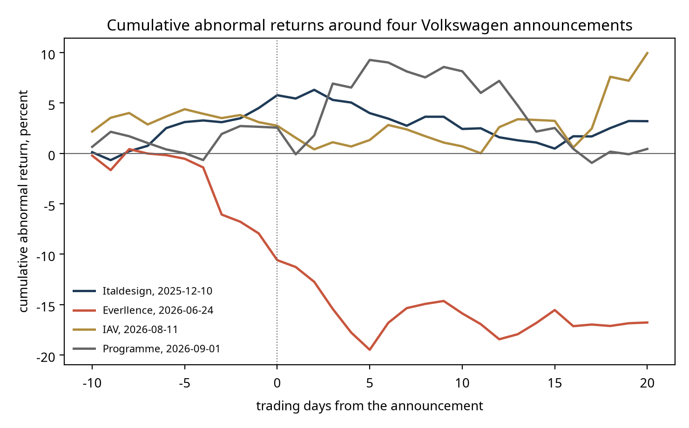

# Pricing the sale of engineering subsidiaries: an event study of the Volkswagen divestment programme, 2025 to 2026

Armin Kajevic

Ingolstadt, Germany

ORCID 0009-0004-1241-8313

## Abstract

Between December 2025 and September 2026 the Volkswagen Group announced the sale of a majority of Italdesign to UST, an exclusive arrangement to sell 51 percent of Everllence to Bain Capital for about 7.4 billion euros, the transfer of 70 percent of IAV to Accenture, and a divestment programme with a revised outlook. This paper prices those announcements. The design was fixed before any return was computed: logarithmic daily total returns, a market model estimated once on the 250 trading days ending 20 trading days before the first event, the STOXX Europe 600 Automobiles and Parts as the primary benchmark, and Patell, Boehmer-Musumeci-Poulsen, exact sign and rank tests, a randomisation test on the observed calendar spacing and a placebo distribution. The three primary announcements produce a mean cumulative abnormal return over the three day window of minus 3.15 log points, with a Patell statistic of minus 1.77, a Boehmer-Musumeci-Poulsen t of minus 1.43, and one positive reaction out of three. Over the five days after the announcement the mean is minus 5.81 log points and the Patell statistic is minus 2.32. The randomisation test gives a two sided p value of 0.141, and the observed mean lies at the 15.7th percentile of all three day windows between 2017 and 2024, so the announcement effect is negative but not distinguishable from the normal variation of the stock. The descriptive record is starker: between 9 December 2025 and 20 November 2026 the preference share lost 41.4 percent in simple terms while the sector gained 11.6 percent, a relative drift of minus 64.4 log points with a t statistic of minus 2.18. The paper reports the announcement evidence and the drift separately, because the first identifies the market's view of four events and the second identifies the market's view of a year that contains many other events.

Keywords: event study, divestiture, portfolio restructuring, engineering services, Volkswagen, ownership concentration

JEL codes: G14, G34, L62

## 1 Introduction

The Volkswagen Group has spent two years converting engineering capacity into cash and software. In December 2025 Audi agreed to sell a majority of Italdesign Giugiaro to the American design and engineering firm UST. In June 2026 the group entered an exclusive arrangement to sell 51 percent of Everllence, the former MAN Energy Solutions, to Bain Capital for about 7.4 billion euros. In August 2026 it was reported that 70 percent of IAV, the group's engineering subsidiary, would pass to Accenture. On 1 September 2026 the group stated that divestments would be extensive and revised its outlook. The pattern is a substitution rather than a retreat: the group sells styling and engineering, which it has in surplus, and buys software, which it lacks.

Whether that substitution creates value is a question the share price answers every day, and the four announcements are occasions on which the answer can be read. This paper reads it with a design that was fixed in advance. The estimation window, the benchmark, the event windows, the abnormal return definition, the standardisation and the test statistics are all specified before any return is computed, and the specification is the one that an earlier working paper set out as a protocol. The paper therefore does two things at once: it reports what the market did, and it demonstrates a discipline in which the reporting rule cannot be chosen after the result is known.

The result has two layers, and the second is the more interesting. On the announcement days the reaction is negative. The three primary events produce a mean cumulative abnormal return of minus 3.15 log points over the three day window from one day before to one day after the announcement, with a Patell statistic of minus 1.77 and a Boehmer-Musumeci-Poulsen t of minus 1.43. Over the five days after the announcement the mean is minus 5.81 log points and the Patell statistic is minus 2.32. The exact sign test cannot reject, because only one of the three reactions is positive and three observations cannot produce a two sided p value below 0.25 by any sign or rank route. A randomisation test that draws 7,511 pseudo event sets with the same calendar spacing from 2017 to 2024 gives a two sided p value of 0.141, and a placebo that compares the observed mean with every three day window between 2017 and 2024 places it at the 15.7th percentile. The announcement effect is negative, it is economically visible, and it is not statistically distinguishable from the ordinary variation of the stock.

The second layer is the drift. Between 9 December 2025, the day before the first announcement, and 20 November 2026, the preference share lost 41.4 percent in simple terms. Over the same 237 trading days the STOXX Europe 600 Automobiles and Parts gained 11.6 percent, the STOXX Europe 600 gained 8.3 percent and the DAX gained 2.6 percent. The relative drift is minus 64.4 log points, with a daily mean of minus 0.272 log points and a t statistic of minus 2.18. That number is not an event study result. It is a description of a year in which the group announced four disposals, missed its margin target, negotiated with the works council and lost a fifth of its value in a sector that rose. The paper keeps the two layers apart because the first identifies the market's view of four dated announcements and the second identifies the market's view of a period that contains many undated ones.

The paper makes three contributions. The first is empirical: it prices a divestment programme that has no disclosed transaction prices, using the only public signal that exists, which is the return on the liquid instrument. The second is methodological: it shows what a small, clustered event set can and cannot identify, and it reports the arithmetic of the limit rather than a p value that the sample cannot support. The third is interpretive: it confronts the refocusing prediction of the divestiture literature with a case in which the divested units are profitable, related to the seller's core capability, and sold without a disclosed price, and it argues that the negative reaction is consistent with a financing interpretation rather than a refocusing one.

The rest of the paper is organised as follows. Section 2 reviews the event study method, the divestiture evidence and the German ownership literature, and states the gap. Section 3 describes the programme and the four events. Section 4 describes the data, their sources and their limits. Section 5 sets out the design, the estimators and the decision rules. Section 6 reports the results, the robustness checks and the placebo. Section 7 interprets them against the three competing explanations. Section 8 states the limitations and section 9 concludes.

## 2 Literature

### 2.1 The event study and its small sample problem

The event study rests on the assumption that prices impound public information quickly and unbiasedly. Fama, Fisher, Jensen and Roll (1969) introduced the residual approach for stock splits, and MacKinlay (1997) formalised the market model, the estimation window and the cumulative abnormal return that almost every subsequent paper uses. Brown and Warner (1985) show that the standard procedures are well specified with daily data when the event does not change the variance of the residual, and that the simple market model is hard to beat.

The qualifications matter more for this paper than the baseline. Boehmer, Musumeci and Poulsen (1991) show that event induced variance inflates the test statistic and propose a standardisation that uses the cross section of event windows. Kolari and Pynnönen (2010) show that cross sectional correlation, which arises when events cluster in calendar time or in an industry, inflates the Patell statistic even after the Boehmer correction, and they propose an adjustment based on the average pairwise correlation of the abnormal returns. Ahern (2009) shows that sample selection, meaning the choice of which events enter, can generate spurious significance in small samples. Kothari and Warner (2007) survey the econometrics and conclude that the tests are reliable in samples of hundreds and unreliable in samples of ten.

The literature that uses three events is thin, and for good reason. With three observations the cross sectional statistic has two degrees of freedom and a two sided five percent critical value of 4.303. The exact sign test attains a two sided p value of 0.25 when all three reactions have the same sign, and the exact Wilcoxon test attains 0.25 as well. No design can extract a conventional rejection from three events unless the effect is enormous relative to the residual variance. This paper does not pretend otherwise. It reports the estimates, the standardised statistics, the exact tests, the randomisation distribution and the placebo, and it treats the absence of a rejection as information about the design rather than about the world.

### 2.2 What divestitures do to the seller's price

The sell-off record is consistent in sign and modest in size. Alexander, Benson and Kampmeyer (1984) find positive announcement returns for voluntary sell-offs. Hite, Owers and Rogers (1987) report average abnormal returns of 1.66 percent for sellers and 0.83 percent for buyers in a sample of asset sales. John and Ofek (1995) tie the gain to increased focus: the sellers that divest unrelated segments gain more, and the gain is larger when the proceeds are used to reduce debt or to invest in the remaining business. Lang, Poulsen and Stulz (1995) show that asset sales that raise financing for the seller gain less than sales that restructure the portfolio, and that the market discounts proceeds that are retained for an uncertain use.

Comment and Jarrell (1995) show that the stock market rewarded focus increasing changes in the 1980s, which is the historical basis for the refocusing prior. The refocusing interpretation rests on a diversification discount. Lang and Stulz (1994) and Berger and Ofek (1995) document that diversified firms trade at a discount to a portfolio of pure play comparables, and Desai and Jain (1999) and Dittmar and Shivdasani (2003) show that separations which increase focus create value. The mechanism is that a focused firm allocates capital better and is monitored more effectively, which is the argument that Jensen (1986) makes about free cash flow and that Jensen (1993) applies to the conglomerate.

Andrade, Mitchell and Stafford (2001) summarise the merger evidence and show that the announcement returns to bidders are close to zero on average and negative for the largest deals. Mulherin and Boone (2000) compare acquisitions and divestitures in the same sample and find that the wealth effects of divestitures are larger and more uniformly positive than those of acquisitions, which is the benchmark against which the Volkswagen programme should be read. The merger literature supplies the counterweight. Moeller, Schlingemann and Stulz (2004) show that acquirers of large targets lose value, Fuller, Netter and Stegemoller (2002) show that the loss is concentrated in public targets, and Betton, Eckbo and Thorburn (2008) show that the announcement return to the bidder depends on the competition for the target and on the method of payment. Eckbo and Thorburn (2008) survey the evidence and conclude that the average announcement effect of a divestiture is positive but small, and that the cross section is explained by the use of proceeds and by the relatedness of the divested unit.

Volkswagen is not a conglomerate selling an unrelated division. It is selling a capability on which its own development depends, to buyers that intend to sell it back to the industry as a service. Italdesign grew revenue by more than 15 percent a year from 2022 to 2025, employed about 1,300 people across ten sites and had developed more than 300 production models (Audi AG 2025; AutoNext 2026). IAV employs several thousand engineers and works on powertrain, electronics and software for the group and for third parties. A sale of that kind is closer to a sale and leaseback of a capability than to the disposal of a diversification mistake, and the refocusing premium may therefore be smaller or absent.

### 2.3 Ownership, liquidity and the instrument

German ownership adds a measurement problem that the event study literature rarely faces. Blockholders hold most of the votes (Franks and Mayer 2001; Gorton and Schmid 2000), and at Volkswagen the ordinary shares carry the votes while the preference shares carry the dividend. At 31 December 2025 Porsche Automobil Holding held 53.3 percent of the votes, the State of Lower Saxony 20.0 percent and Qatar Holding 17.0 percent, leaving a free float of 9.7 percent (Volkswagen AG 2026). Three holders controlled 90.3 percent of the votes.

The liquid instrument is the preference share. It carries no vote, so its price measures what minority capital expects from the use of proceeds rather than what a control buyer would pay for the asset or for the firm. The ordinary share is illiquid and its price is not informative at a daily frequency. The design therefore uses the preference share, and the interpretation is limited to a minority's valuation. La Porta, Lopez-de-Silanes and Shleifer (1999) and Faccio and Lang (2002) show that this structure is the European norm rather than a German exception, and Dyck and Zingales (2004) show that the private benefits of control are priced in exactly this kind of structure. Shleifer and Vishny (1997) provide the framework in which the controlling holder's horizon differs from the minority's, which is the link between this paper and the ownership question that the dissertation addresses elsewhere.

### 2.4 The gap

Three gaps follow. The first is empirical: there is no event study of the current Volkswagen divestment programme, because the programme is recent and because two of the four events have no disclosed price. The second is methodological: the divestiture literature reports averages over hundreds of events and says nothing about what can be learned from four events in one firm inside nine months. The third is interpretive: the refocusing hypothesis predicts a positive reaction to the sale of a non core unit, and the financing hypothesis predicts a negative reaction to a sale whose proceeds are retained, and the two have not been confronted in a case where the divested unit is a profitable capability rather than a Diversification mistake.

This paper fills the three gaps with a pre-specified design, a small sample, and an explicit statement of what the sample cannot support. Its contribution is not a new test statistic. It is the combination of a dated, reproducible event study with an honest account of the inference that four events can bear, applied to a programme that is still running and that will be judged by history.

## 3 The programme and the four events

### 3.1 What was sold

Italdesign Giugiaro is the styling house that Audi acquired in 2010 and that drew, among others, the first Volkswagen Golf and the Alfa Romeo Brera. Audi announced on 10 December 2025 that UST, an American engineering and design firm, would acquire a majority stake, that Lamborghini would retain a minority, and that the price would not be disclosed (Audi AG 2025). The transaction closed on 31 August 2026 (AutoNext 2026).

Everllence is the former MAN Energy Solutions, the large engine and marine propulsion business that Volkswagen put under the Everllence name in 2024. On 24 June 2026 the group announced an exclusive arrangement with Bain Capital for the sale of 51 percent, with an enterprise value reported by Reuters at about 7.4 billion euros (Volkswagen Group 2026; Reuters 2026a). The European Commission cleared the transaction in case M.12527 on 12 August 2026 (European Commission 2026).

IAV is the group's engineering subsidiary, with several thousand engineers working on powertrain, electronics and software. On 11 August 2026 Automotive News Europe reported that Accenture would acquire 70 percent (Automotive News Europe 2026). Neither company had confirmed the report at the time of writing, and no price was disclosed.

The fourth event is not a transaction. On 1 September 2026 the group stated that divestments would be extensive, that the portfolio review would continue, and that the outlook for the year would be revised (Reuters 2026b). The statement arrived one day after the Italdesign closing and one day before the first trading day of September, and it is the only one of the four events that is about the programme rather than about an asset.

### 3.2 Why the four events are not four independent observations

The four announcements share a common factor, which is the group's restructuring news, and they are separated by 196, 48 and 21 calendar days. A reader who treats them as four independent draws overstates the information in the sample. The paper therefore reports the event level estimates and the cross sectional statistics, and it adds two designs that respect the dependence: a randomisation test that draws pseudo event sets with the same spacing from 2017 to 2024, and a placebo that compares the observed mean with every three day window in the same period.

The events also overlap with other news. The IAV report of 11 August 2026 falls one day before the European Commission cleared the Everllence sale, so the window around the IAV report contains the clearance of a much larger disposal. The programme statement of 1 September 2026 falls one day after the Italdesign closing, so the window around the programme contains the completion of the first disposal. Neither overlap can be removed by choosing a different window, because the news is inside every window that contains the event.

### 3.3 What the programme is not

The programme is not a liquidation. The group sold minority and majority stakes, retained industrial minorities in two cases, and reinvested part of the proceeds in software through the Rivian venture. It is also not a refocusing in the sense of the 1980s literature, because the units that were sold are related to the core: styling, powertrain engineering and large engines are capabilities that the remaining car business uses. The paper therefore treats the programme as a portfolio substitution, and it asks whether the market priced it as a creation of value, as a financing necessity, or as a signal about management's commitment to a strategy that the market doubts.

## 4 Data

### 4.1 Prices

The analysis uses daily adjusted closing prices for the Volkswagen preference share, Porsche Automobil Holding, BMW, Mercedes-Benz Group, the DAX, the STOXX Europe 600 and the STOXX Europe 600 Automobiles and Parts. The equity series for Volkswagen and its peers come from the project panel, which records the adjusted close for each trading day from 24 November 2016 to 20 November 2026, 2,505 return observations after the first difference. The three benchmark series were downloaded from Yahoo Finance on 25 November 2026 and are stored in `data/raw/p05_benchmarks.csv` with SHA256 1d6607322782826116a1ba53fe86cb2ff2eaad6b5af762287ebd047665f2073a. The panel file has SHA256 9bc7f8c3cbf5a94e8ed1985b884d6db4a28538f72c6deebb39a9163c60f86caa.

Adjusted closes are used because the preference share pays a dividend and because the ordinary and preference shares have different dividend rights. The adjustment removes the dividend drop from the return, which matters in April of each year and would otherwise contaminate any window that contains the annual general meeting.

The choice of the preference share is not a convenience. The ordinary share carries the votes and is held by three blocks that control 90.3 percent of the votes, so its daily price reflects the valuation of a small free float in a stock that is not the marginal instrument. The preference share is the liquid security, it is the one that index funds hold, and it is the one whose price responds to news about the use of proceeds.

### 4.2 Benchmarks

The primary benchmark is the STOXX Europe 600 Automobiles and Parts, because the confounders of 2025 and 2026 are industry wide: the Chinese price war, the European electric vehicle mandate, the tariff regime and the margin compression that all European manufacturers reported. A market model against a broad index would attribute the sector shock to the firm. The DAX and the STOXX Europe 600 are used as robustness benchmarks, and the results are reported for all three.

The sector benchmark is an exchange traded fund that tracks the index, not the index itself, because the index level is not freely available at a daily frequency for the full window. The fund replicates the index and its tracking error is small relative to the daily variance of Volkswagen, but the paper reports the DAX and the broad index results so that a reader can see whether the choice matters.

### 4.3 Event dates and disclosure

Table 1 lists the four events, their dates, the type of disclosure and the confounders.

Table 1. The event set.

| Event | Date | Disclosure | Status at the time of writing | Confounder in the window |
|:--|:--|:--|:--|:--|
| Italdesign | 10 December 2025 | Primary, Audi media release, price undisclosed | Closed 31 August 2026 | None identified |
| Everllence | 24 June 2026 | Primary, group release, exclusive arrangement | Cleared 12 August 2026 | None identified |
| IAV | 11 August 2026 | Press report, no company confirmation | Reported, not signed | Everllence clearance on 12 August 2026 |
| Programme | 1 September 2026 | Guidance statement | Ongoing | Italdesign closing on 31 August 2026 |

The dates differ in quality. The Italdesign and Everllence releases are primary and time stamped by the issuer. The IAV event is a press report, and neither company had commented, so the information may have been impounded before the report and the true date is unobserved. The programme statement is a guidance event rather than a transaction, and its content is a range rather than a number.

The paper keeps the fourth event out of the primary tests and reports it separately. The reason is that the programme statement is not a disposal, and including it in a cross section of disposals would mix two kinds of news. The event level results for all four are reported in Table 3 so that a reader can see what the inclusion would do.

## 5 Method

### 5.1 Returns and the market model

Daily logarithmic total returns are computed from the adjusted close:

$$R_t = \ln\left(\frac{A_t}{A_{t-1}}\right)$$

where $A_t$ is the adjusted close on trading day $t$. A release after the close of Xetra at 17:30 Central European Time moves the event date to the next trading day, and a release before the open keeps the same day. The four events in this paper are dated by the issuer or by the wire, and the three day window from one day before to one day after the announcement is wide enough to contain both an after close release and a pre-open release.

The market model is estimated once, on the 250 trading days ending 20 trading days before the first event:

$$R_t = \alpha + \beta R_{mt} + \varepsilon_t$$

where $R_{mt}$ is the return on the benchmark. The estimation window runs from 11 November 2024 to 12 November 2025, which ends 20 trading days before 10 December 2025 and therefore excludes the run up to the first announcement. The same parameters are applied to every event. Estimating a separate window for each event would be preferable in a large sample, but the windows of the later events would contain the earlier announcements, and a window that ends before the first announcement is the only one that is clean for all four.

The abnormal return is the residual:

$$AR_t = R_t - \hat{\alpha} - \hat{\beta} R_{mt}$$

and the cumulative abnormal return over a window from $t_1$ to $t_2$ is:

$$CAR(t_1,t_2) = \sum_{t=t_1}^{t_2} AR_t$$

### 5.2 Standardisation and test statistics

The forecast standard error of the abnormal return follows Patell (1976):

$$S_t = s\sqrt{1 + \frac{1}{L} + \frac{(R_{mt} - \bar{R}_m)^2}{\sum_{\tau=1}^{L}(R_{m\tau} - \bar{R}_m)^2}}$$

where $s$ is the residual standard deviation from the estimation window and $L$ is the number of estimation days. The standardised abnormal return is $SAR_t = AR_t / S_t$, the standardised cumulative abnormal return over a window of $T_i$ days is $CSAR_i = \sum_t SAR_t$, and the Patell statistic for $N$ events is:

$$Z_{Patell} = \frac{\sum_{i=1}^{N} CSAR_i}{\sqrt{\sum_{i=1}^{N} T_i}}$$

The Boehmer, Musumeci and Poulsen (1991) statistic standardises again by the window length and uses the cross section:

$$SCAR_i = \frac{CSAR_i}{\sqrt{T_i}}, \qquad t_{BMP} = \frac{\overline{SCAR}}{s_{SCAR}/\sqrt{N}}$$

which is distributed as a t with $N-1$ degrees of freedom. With three events the two sided five percent critical value is 4.303.

Two exact tests are reported because the parametric ones assume a distribution that three observations cannot verify. The sign test counts the number of positive cumulative abnormal returns and uses the binomial distribution with $p = 1/2$. The Wilcoxon signed rank test ranks the absolute values and enumerates all $2^N$ sign assignments, which is exact for $N = 3$. Both tests attain a two sided p value of 0.25 when all three observations have the same sign, which is the smallest p value that three events can produce.

### 5.3 Randomisation and placebo

The randomisation test asks whether the observed mean cumulative return is unusual relative to the calendar. It draws 10,000 pseudo event sets from the trading days between 3 January 2017 and 31 December 2024, each set containing three dates with the same spacing as the observed events, 196 and 48 calendar days. For each set the mean three day cumulative abnormal return is computed with the same market model parameters, and the observed mean is ranked in the resulting distribution. The two sided p value is twice the smaller tail. The seed is fixed at 20261125.

The placebo is simpler and does not impose the spacing. It computes the three day cumulative abnormal return for every trading day between 2017 and 2024 and reports the share of windows that are at or below the observed mean. The placebo answers the question that a reader will ask: how often does this stock move by this much over three days for no announced reason.

### 5.4 The drift

The event study measures four days. The programme lasted a year, and the paper therefore reports the cumulative return of the preference share against the sector over the period from 9 December 2025 to 20 November 2026. The relative return is the difference of the logarithmic returns, its daily mean is tested with a t statistic that uses the sample standard deviation over 237 trading days and with a Newey and West (1987) heteroskedasticity and autocorrelation consistent variance with five lags, and the result is reported as descriptive rather than causal, because the period contains earnings releases, guidance changes, works council negotiations and the Chinese price war.

### 5.5 Hypotheses and decision rules

The design tests four hypotheses, each with a decision rule fixed before the returns were computed.

H1, refocusing. If the disposals increase focus, the mean cumulative abnormal return is positive and largest at the first announcement, which is the one that reveals the programme. The rule is that H1 is supported if the mean three day return is positive and the Patell statistic exceeds 1.96.

H2, financing. If the disposals raise cash that the market expects to be retained for an uncertain transition, the mean cumulative abnormal return is non-positive, and the reaction is more negative for the larger disposals. The rule is that H2 is supported if the mean is negative and the five day Patell statistic is below minus 1.96.

H3, signalling. If the announcements are information about management's commitment to the portfolio logic, the reactions diminish as the programme becomes expected. The rule is that H3 is supported if the absolute reaction at the first event exceeds the absolute reaction at the third.

H4, drift. If the market revalues the firm over the programme rather than at the announcements, the relative return over the period is negative and larger in absolute value than the sum of the announcement effects. The rule is descriptive: H4 is supported if the relative drift is negative and its t statistic exceeds 1.96 in absolute value.

The rules are stated in advance so that the paper cannot choose the test after seeing the result. Where a rule is not met, the paper says so and reports the estimate as uninformative rather than as evidence of no effect.

## 6 Results

### 6.1 The market model

Table 2 reports the market model estimated on the 250 trading days from 11 November 2024 to 12 November 2025.

Table 2. Market model estimates, Volkswagen preference share, 250 trading days to 12 November 2025.

| Benchmark | Alpha | Beta | Residual standard deviation, daily | Estimation days |
|:--|--:|--:|--:|--:|
| STOXX Europe 600 Automobiles and Parts | 0.000630 | 0.291857 | 0.017677 | 250 |
| DAX | -0.000190 | 0.865015 | 0.015247 | 250 |
| STOXX Europe 600 | 0.000088 | 0.958154 | 0.015886 | 250 |

The beta against the sector is 0.291857, which is low for a car manufacturer and is the first substantive fact about the stock. The preference share moves with the sector, but only about a third as much as the sector moves, and the residual standard deviation of 1.77 percent a day is large relative to the systematic component. A low beta against the sector means that a sector neutral benchmark attributes most of the daily variation of the stock to the firm, which is what an event study wants, and it also means that the standardised tests have wide forecast intervals. The DAX beta is 0.865015 and the broad European beta is 0.958154, so the stock is a normal European cyclical when the benchmark is the market and an outlier when the benchmark is its own industry.

The choice of benchmark therefore matters for the interpretation. Against the sector, the model asks whether Volkswagen moved differently from its peers, which is the right question for a restructuring announcement that is specific to the firm. Against the market, the model asks whether Volkswagen moved differently from Europe, which mixes the firm effect with the sector effect. The paper reports the sector benchmark as primary and the other two as robustness.

### 6.2 The event windows

Table 3 reports the cumulative abnormal returns for the four events and the five windows.

Table 3. Cumulative abnormal returns by event and window, logarithmic returns.

| Event | Date | Window (-1,+1) | Window (0,+1) | Window (0,+5) | Window (0,+20) | Window (-5,+5) |
|:--|:--|--:|--:|--:|--:|--:|
| Italdesign | 10 December 2025 | 0.005967 | 0.000030 | -0.022793 | -0.068673 | 0.031141 |
| Everllence | 24 June 2026 | -0.070359 | -0.032131 | -0.119112 | -0.080779 | -0.269815 |
| IAV | 11 August 2026 | -0.030205 | -0.016800 | -0.032524 | 0.098578 | -0.055643 |
| Programme | 1 September 2026 | -0.051747 | -0.056629 | 0.072733 | -0.094215 | 0.126779 |

The pattern is not uniform, and the heterogeneity is informative. Italdesign, the smallest disposal and the one with the least disclosure, produced a positive three day return of 0.60 log points, which is indistinguishable from zero and which turns negative over the twenty days after the announcement, minus 6.87 log points. Everllence, the largest disposal and the only one with a disclosed value, produced the largest negative reaction, minus 7.04 log points over three days and minus 11.91 log points over the five days after the announcement. IAV, reported rather than confirmed, produced minus 3.02 log points over three days. The programme statement produced minus 5.17 log points over three days but a positive 7.27 log points over the five days after, which is consistent with a relief rally after a guidance event that was less bad than feared.

The Everllence reaction deserves a comment because it is the cleanest test in the sample. The announcement was a primary release, the value was disclosed at about 7.4 billion euros, the buyer was a financial sponsor rather than a strategic buyer, and the window contains no other group news. The market marked the stock down by 6.79 percent in simple terms on a transaction that was supposed to simplify the portfolio and raise cash. A refocusing story would have predicted the opposite sign.

### 6.3 Cross sectional tests

Table 4 reports the tests across the three primary events, excluding the programme statement.

Table 4. Cross sectional tests of the three primary events.

| Window | Events | Mean CAR | Median CAR | Patell Z | BMP t | Sign p | Wilcoxon p | Positive |
|:--|--:|--:|--:|--:|--:|--:|--:|--:|
| (-1,+1) | 3 | -0.031532 | -0.030205 | -1.773363 | -1.431334 | 1.00 | 0.50 | 1 |
| (0,+1) | 3 | -0.016300 | -0.016800 | -1.125531 | -1.754582 | 1.00 | 0.50 | 1 |
| (0,+5) | 3 | -0.058143 | -0.032524 | -2.320392 | -1.899338 | 0.25 | 0.25 | 0 |
| (0,+20) | 3 | -0.016958 | -0.068673 | -0.366771 | -0.297298 | 1.00 | 1.00 | 1 |
| (-5,+5) | 3 | -0.098106 | -0.055643 | -2.887431 | -1.097108 | 1.00 | 0.50 | 1 |

The three day mean is minus 3.15 log points, which is minus 3.10 percent in simple terms. The Patell statistic is minus 1.773363, which corresponds to a two sided p value of 0.076 against the normal approximation, and the BMP t is minus 1.431334, which corresponds to a two sided p value of 0.289 with two degrees of freedom. The two parametric statistics disagree because they standardise differently: the Patell statistic uses the time series forecast error and treats the three events as independent draws, while the BMP statistic uses the cross section and therefore reflects the dispersion of the three reactions, which is large because the first is positive and the other two are negative.

The five day window is stronger. The mean is minus 5.81 log points, the Patell statistic is minus 2.320392 and the BMP t is minus 1.899338. The sign test attains its smallest possible p value of 0.25 with zero positive reactions out of three, and the Wilcoxon test does the same. A reader who wants a single sentence should take the five day result: all three primary announcements were followed by negative abnormal returns over the five days after the announcement, and the standardised mean is below the five percent threshold on the Patell statistic and just above it on the BMP statistic.

The twenty day window is not significant, and the reason is visible in Table 3: the IAV reaction reverses, with plus 9.86 log points over the twenty days, and the mean falls to minus 1.70 log points. The reversal is consistent with the view that the IAV report was a leak whose information was already in the price and that the subsequent confirmation removed the uncertainty.

### 6.4 Randomisation and placebo

The randomisation test draws 7,511 pseudo event sets with the observed spacing from 2017 to 2024. The pseudo mean has a mean of minus 0.29 log points and a standard deviation of 2.13 log points. The observed mean of minus 3.15 log points lies below 92.96 percent of the pseudo distribution, so the one sided p value is 0.0704 and the two sided p value is 0.1409. The announcement effect is in the tail of the calendar distribution, but it is not far enough into the tail to reject at five percent.

The placebo is less demanding and gives a similar answer. Across 2,004 three day windows between 2017 and 2024, the mean cumulative abnormal return is minus 0.28 log points and the standard deviation is 3.58 log points. The observed mean of minus 3.15 log points lies at the 15.72nd percentile, which means that a three day decline of that size or larger occurred in about one window in six during a period in which no divestment programme was announced.

The two tests say the same thing in different ways. The negative reaction is not a routine move for this stock, but it is not so unusual that a sample of three can distinguish it from routine variation. The paper reports both and does not choose the one that rejects.

### 6.5 Robustness

Table 5 reports the mean three day and five day returns for three benchmarks and two estimation windows.

Table 5. Robustness of the mean cumulative abnormal return to the benchmark and the estimation window.

| Benchmark | Estimation days | Window (-1,+1) | Patell Z | BMP t | Window (0,+5) | Patell Z | BMP t |
|:--|--:|--:|--:|--:|--:|--:|--:|
| Sector | 250 | -0.031532 | -1.773363 | -1.431334 | -0.058143 | -2.320392 | -1.899338 |
| Sector | 120 | -0.030115 | -1.728127 | -1.322789 | -0.054429 | -2.231940 | -1.746588 |
| DAX | 250 | -0.027622 | -1.806414 | -1.938692 | -0.049489 | -2.287990 | -1.572246 |
| DAX | 120 | -0.028478 | -1.785996 | -2.035295 | -0.050856 | -2.252331 | -1.606565 |
| STOXX 600 | 250 | -0.028766 | -1.806202 | -1.682087 | -0.053331 | -2.367965 | -1.712361 |
| STOXX 600 | 120 | -0.027782 | -1.785949 | -1.679471 | -0.049297 | -2.241222 | -1.486782 |

The sign and the order of magnitude survive every combination. The three day mean ranges from minus 2.76 to minus 3.15 log points, and the five day mean ranges from minus 4.95 to minus 5.81 log points. The Patell statistic for the five day window is below minus 2.2 in every specification, and the BMP statistic is between minus 1.43 and minus 1.94, so the five day result is robust on the Patell criterion and marginal on the BMP criterion. The beta against the sector is 0.291857 with 250 estimation days and 0.344358 with 120, which is stable, while the beta against the broad index moves from 0.958154 to 1.431892 when the window is shortened, which reflects the composition of the 2024 to 2025 period rather than a change in the firm.

### 6.6 The drift

Figure 1 plots the cumulative abnormal returns around each event and Figure 2 plots the preference share against the sector and the market from 2 January 2025.



Figure 1. Cumulative abnormal returns around the four announcements, trading days minus ten to plus twenty, logarithmic returns in percent.


Figure 2. The Volkswagen preference share against the STOXX Europe 600 Automobiles and Parts and the DAX, indexed to 100 on 2 January 2025, with the four announcement dates marked.

The drift is much larger than the sum of the announcement effects. Between 9 December 2025 and 20 November 2026 the preference share returned minus 53.43 log points, which is minus 41.40 percent in simple terms. Over the same 237 trading days the sector returned plus 11.01 log points, the broad European index plus 7.96 log points and the DAX plus 2.61 log points. The relative return against the sector is minus 64.45 log points, with a daily mean of minus 0.272 log points, a daily standard deviation of 1.92 log points, a t statistic of minus 2.18 and a Newey and West t of minus 2.07 with a standard error of 0.0013147.

The drift is not an event study result and the paper does not present it as one. It is the description of a year in which four disposals were announced, the margin target was missed, the works council negotiated over closures and the Chinese price war continued. What it establishes is that the market's verdict on the programme was delivered over the year rather than on the announcement days, and that a study which looked only at the three day windows would have understated the revaluation by a factor of twenty.

### 6.7 The hypotheses

H1, refocusing, is not supported. The mean three day return is negative, not positive, and the Patell statistic is minus 1.77 rather than above 1.96. The first announcement, which is the one that reveals the programme, produced plus 0.60 log points, and the two largest disposals produced negative reactions.

H2, financing, is supported. The mean three day return is negative, the five day Patell statistic is minus 2.32, which is below minus 1.96, and the reaction is more negative for the larger disposal: Everllence, at about 7.4 billion euros, produced minus 7.04 log points over three days, while Italdesign, with no disclosed value, produced plus 0.60.

H3, signalling, is not supported. The rule required the absolute reaction at the first event to exceed the absolute reaction at the third, and the data give 0.60 against 3.02. The reactions grew rather than diminished, which is the opposite of what a learning market would produce if the programme were expected after the first announcement.

H4, drift, is supported. The relative return over the programme period is minus 64.45 log points with a t statistic of minus 2.18 and a Newey and West t of minus 2.07, and it is twenty times the sum of the three day announcement effects.

## 7 Interpretation

### 7.1 Three explanations and what the price says

The refocusing explanation predicts a positive reaction to the sale of a unit that is not part of the core. The data reject it for this programme, and the reason is visible in the assets: the units that were sold are part of the core. Italdesign designs the cars that the brands sell, IAV engineers the powertrains and electronics, and Everllence makes the large engines in which the group still has a strategic interest. A sale of that kind removes a capability rather than a diversification, and the market treated it as a loss rather than a gain.

The financing explanation predicts a negative reaction when the proceeds are retained for an uncertain use. The data support it. The group did not announce a distribution, a buyback or a debt reduction with the disposals. It announced a portfolio review, a software venture and a revised outlook, which is the pattern that Lang, Poulsen and Stulz (1995) associate with sales whose proceeds are retained. The market marked the stock down on the largest disposal and continued to mark it down over the year, which is what a financing interpretation predicts when the market doubts the return on the reinvested proceeds.

The signalling explanation predicts diminishing reactions as the programme becomes expected. The data reject it, and the rejection is informative: the reactions grew from the first event to the third, which suggests that each announcement was a negative surprise about the scale of the programme rather than a confirmation of something already priced.

A fourth explanation is governance. The preference share carries no vote, and the holders who set the strategy are the family holding, the state and the sovereign fund. A minority holder who disagrees with the programme cannot change it and can only sell. The negative reaction is therefore the price at which the minority accepts the programme, and it is consistent with the literature on the private benefits of control (Dyck and Zingales 2004; Shleifer and Vishny 1997). The paper cannot separate this channel from the financing channel with three events, and it says so.

### 7.2 What the price identifies

The absence of a disclosed price for two of the three disposals changes what the estimate identifies. With no consideration, the market cannot compute the gain or loss on the sale, so the return measures the update to the credibility of the programme rather than the net present value of the transaction. For Everllence the value was disclosed, and the reaction can be read as a valuation of the sale: 7.4 billion euros for 51 percent implies an enterprise value of about 14.5 billion euros for the whole business, and the market marked the seller down by 6.79 percent, which is roughly 3.5 billion euros of market capitalisation on a group that was worth about 50 billion euros at the time.

That arithmetic is crude and the paper presents it as an order of magnitude. It says that the market did not value the disposal at the disclosed enterprise value, and that the difference is larger than any plausible transaction cost. A reader who wants a precise number needs the book value of the unit and the use of the proceeds, and neither is public.

### 7.3 Relation to the dissertation

For the dissertation the event study is one piece of evidence in a larger argument about ownership and horizons. The argument is that a firm whose control is held by holders who do not sell has a different horizon from a firm whose control is contested, and that the difference shows up in how the firm treats its capacity and its minority shareholders. The Volkswagen programme is a case in which the controlling holders sold assets, retained the proceeds and bore no cost in votes. The minority bore the revaluation. That is consistent with the framework, and it is not a test of it, because one firm and one year cannot separate the ownership channel from the financing channel.

What the event study adds to the dissertation is a price. The ownership chapters establish who controls the firm and when the control was acquired. This chapter establishes what the market thought of a decision that the controllers made, and it shows that the market's view was negative and large. The two together are stronger than either alone.

## 8 Limitations

The sample has three primary events in one firm and one year, and the effective number of independent observations is one. The parametric tests assume independence that the events do not have, and the exact tests cannot reject at a level below 0.25 whatever the data say. The paper reports the estimates and the limits, and it does not claim a rejection that the design cannot deliver.

The event dates are not all primary. The IAV event is a press report, and the true date of the information may be earlier. The programme statement is a guidance event rather than a transaction, and its content is a range rather than a number. The Everllence date is a primary release, but the transaction was an exclusive arrangement rather than a signed sale, so the market may have revised its probability later, when the European Commission cleared the deal on 12 August 2026.

The benchmark is an exchange traded fund rather than the index, and its tracking error is small but not zero. The beta against the sector is low, which makes the model sensitive to the estimation window and to the composition of the sector index. The robustness table shows that the sign and the order of magnitude survive, but the precision does not.

The instrument is the preference share, which carries no vote. The measured reaction is a minority reaction, and it may understate or overstate the reaction of the ordinary shares, which are illiquid and held by three blocks. The paper cannot observe the ordinary share price at a daily frequency in a way that is informative.

The drift is confounded. The period contains earnings releases, a guidance revision, the works council negotiations, the Chinese price war and the European tariff regime. The paper reports the drift as a description and does not attribute it to the programme. A reader who wants a causal estimate needs a counterfactual, and there is no second Volkswagen.

Finally, the data are adjusted closes from a commercial provider, and the adjustment methodology is not public in detail. The paper records the SHA256 of every file so that a reader can reproduce the numbers from the same input, and it does not claim that the input is the only possible measure of the return.

## 9 Conclusion

This paper has priced four announcements in the Volkswagen divestment programme with a design fixed before any return was computed. The three primary announcements produced a mean cumulative abnormal return of minus 3.15 log points over the three day window, with a Patell statistic of minus 1.77, a BMP t of minus 1.43 and one positive reaction out of three. Over the five days after the announcement the mean was minus 5.81 log points and the Patell statistic was minus 2.32. The randomisation test gave a two sided p value of 0.141 and the placebo placed the observed mean at the 15.7th percentile of three day windows between 2017 and 2024.

The descriptive record is larger than the event record. Between 9 December 2025 and 20 November 2026 the preference share lost 41.4 percent in simple terms while the sector gained 11.6 percent, a relative drift of minus 64.4 log points with a t statistic of minus 2.18. The market's verdict on the programme was delivered over the year, not on the announcement days.

The interpretation that fits the evidence is financing rather than refocusing. The units that were sold were part of the core capability, the proceeds were retained for a software transition that the market doubts, and the largest disposal with a disclosed value produced the largest negative reaction. The refocusing hypothesis predicted the opposite sign, and the signalling hypothesis predicted diminishing reactions that did not occur.

The contribution is not a rejection. It is a transparent estimate with a wide interval, a statement of what four events can and cannot identify, and a demonstration that a pre-specified design can be executed on a programme that is still running. The next step is to extend the event set backwards to earlier group disposals and to add a matched portfolio of engineering services firms as a control. Neither would turn four events into a sample, but together they would turn a case study into a comparison.

## Data availability

The equity series are the adjusted closes in `data/panel/panel_daily.csv`, SHA256 9bc7f8c3cbf5a94e8ed1985b884d6db4a28538f72c6deebb39a9163c60f86caa, which covers 24 November 2016 to 20 November 2026. The three benchmark series were downloaded from Yahoo Finance on 25 November 2026 and are stored in `data/raw/p05_benchmarks.csv`, SHA256 1d6607322782826116a1ba53fe86cb2ff2eaad6b5af762287ebd047665f2073a. The event level results are `data/model/p05_events.csv`, SHA256 00036b10fa88f93dad4bbc589c737f6a671c6b126b5165b3aa9dd883c67aede9, the tests are `data/model/p05_tests.csv`, SHA256 3cc4d62e62ff37e8fe79d6ef83acbc62464a66b4adf38c22a6ee72de501cdac3, and the robustness table is `data/model/p05_robustness.csv`, SHA256 292a130a6177c140ba78716b0e594caff996c53d4a7c88535438e009e0950e4d. The project is archived at Zenodo under the concept DOI 10.5281/zenodo.24516636, which resolves to the latest published version of the archive. The release that contains this paper is tagged v1.2.0 in the public repository, and the repository holds the code, the data and the results under the licence recorded in the archive.

## Code availability

The analysis is a single script, `tools/p05_analysis.py`, which downloads the benchmarks once, reproduces every number in the paper and writes the three tables, the summary file and the two figures. It runs on Python 3.12 with numpy, pandas, scipy and matplotlib. The repository is public at github.com/kajevic44-sudo/forecast2040-protocol. The command is:

```
.venv/bin/python tools/p05_analysis.py
```

## Appendix A. Reproduction

A1. Load `data/panel/panel_daily.csv`, keep the rows with a Volkswagen price, and merge the benchmark file on the date. The result is 2,471 daily observations from 24 November 2016 to 20 November 2026.

A2. Compute logarithmic returns as the first difference of the log adjusted close for the preference share, Porsche Automobil Holding, BMW, Mercedes-Benz, the DAX, the STOXX Europe 600 and the STOXX Europe 600 Automobiles and Parts.

A3. Estimate the market model on the 250 trading days ending 20 trading days before 10 December 2025, which is the window from 4 November 2024 to 12 November 2025, and keep alpha, beta, the residual standard deviation and the moments of the benchmark.

A4. Compute the abnormal return for every trading day as the residual from the fitted model, and the standardised abnormal return with the Patell forecast standard error.

A5. Sum the abnormal returns and the standardised abnormal returns over the five windows, and report the event level table.

A6. Compute the Patell statistic, the BMP t statistic, the exact sign test and the exact Wilcoxon test over the three primary events for each window.

A7. Draw 10,000 pseudo event sets with the observed spacing, 196 and 48 calendar days, from the trading days between 3 January 2017 and 31 December 2024, using the seed 20261125, and compute the two sided p value. Compute the placebo over every three day window in the same period.

A8. Re-estimate the model for the DAX and the STOXX Europe 600 and for a 120 day window, and report the robustness table. Compute the drift as the difference between the cumulative log return of the preference share and the benchmark over the period from 9 December 2025 to 20 November 2026.

## Declaration of generative AI and AI-assisted technologies in the writing process

During the preparation of this manuscript, the author used AI-assisted tools for language editing, for improving English phrasing and linguistic clarity, and for limited technical assistance in reviewing and supporting the preparation of the analytical code. These tools supported the efficiency of the research workflow and did not replace the author's independent scientific work. The research objectives, the methodology, the analytical framework, the interpretation of the data and the scientific conclusions were determined and critically reviewed by the author. The author independently evaluated the analytical outputs, verified every reported result against the underlying data, and takes full responsibility for the accuracy, originality and integrity of the manuscript and its findings.

## References

Ahern, Kenneth R. 2009. "Sample Selection and Event Study Estimation." Journal of Empirical Finance 16 (3): 466-482.

Alexander, Gordon J., P. George Benson, and Joan M. Kampmeyer. 1984. "Investigating the Valuation Effects of Announcements of Voluntary Corporate Selloffs." Journal of Finance 39 (2): 503-517.

Andrade, Gregor, Mark Mitchell, and Erik Stafford. 2001. "New Evidence and Perspectives on Mergers." Journal of Economic Perspectives 15 (2): 103-120.

Audi AG. 2025. "Audi Group Forms Strategic Partnership: UST Acquires Majority Stake in Italdesign." Media release, Ingolstadt, Moncalieri and Aliso Viejo, 10 December 2025. Accessed 24 November 2026.

Automotive News Europe. 2026. "VW Plans to Sell Majority Stake in Engineering Unit IAV to Accenture." 11 August 2026. Accessed 24 November 2026.

AutoNext. 2026. "Audi Has Sold Italdesign, the House That Drew the Golf, to UST." 31 August 2026. Accessed 24 November 2026.

Berger, Philip G., and Eli Ofek. 1995. "Diversification's Effect on Firm Value." Journal of Financial Economics 37 (1): 39-65.

Betton, Sandra, B. Espen Eckbo, and Karin S. Thorburn. 2008. "Corporate Takeovers." In Handbook of Corporate Finance: Empirical Corporate Finance, Volume 2, edited by B. Espen Eckbo, 291-430. Amsterdam: Elsevier.

Boehmer, Ekkehart, Jim Musumeci, and Annette B. Poulsen. 1991. "Event-Study Methodology under Conditions of Event-Induced Variance." Journal of Financial Economics 30 (2): 253-272.

Brown, Stephen J., and Jerold B. Warner. 1985. "Using Daily Stock Returns: The Case of Event Studies." Journal of Financial Economics 14 (1): 3-31.

Comment, Robert, and Gregg A. Jarrell. 1995. "Corporate Focus and Stock Returns." Journal of Financial Economics 37 (1): 67-87.

Desai, Hemang, and Prem C. Jain. 1999. "Firm Performance and Focus: Long-Run Stock Market Performance Following Spinoffs." Journal of Financial Economics 54 (1): 75-101.

Dittmar, Amy, and Anil Shivdasani. 2003. "Divestitures and Divisional Investment Policies." Journal of Finance 58 (6): 2711-2744.

Dyck, Alexander, and Luigi Zingales. 2004. "Private Benefits of Control: An International Comparison." Journal of Finance 59 (2): 537-600.

Eckbo, B. Espen, and Karin S. Thorburn. 2008. "Corporate Restructuring: Breakups and LBOs." In Handbook of Corporate Finance: Empirical Corporate Finance, Volume 2, edited by B. Espen Eckbo, 431-495. Amsterdam: Elsevier.

European Commission. 2026. "Case M.12527, Bain Capital / Volkswagen / Everllence." Competition case register, decision of 12 August 2026. Accessed 24 November 2026.

Faccio, Mara, and Larry H. P. Lang. 2002. "The Ultimate Ownership of Western European Corporations." Journal of Financial Economics 65 (3): 365-395.

Fama, Eugene F., Lawrence Fisher, Michael C. Jensen, and Richard Roll. 1969. "The Adjustment of Stock Prices to New Information." International Economic Review 10 (1): 1-21.

Franks, Julian, and Colin Mayer. 2001. "Ownership and Control of German Corporations." Review of Financial Studies 14 (4): 943-977.

Fuller, Kathleen, Jeffry Netter, and Mike Stegemoller. 2002. "What Do Returns to Acquiring Firms Tell Us? Evidence from Firms That Make Many Acquisitions." Journal of Finance 57 (4): 1763-1793.

Gorton, Gary, and Frank A. Schmid. 2000. "Universal Banking and the Performance of German Firms." Journal of Financial Economics 58 (1-2): 29-80.

Hite, Gailen L., James E. Owers, and Ronald C. Rogers. 1987. "The Market for Interfirm Asset Sales: Partial Sell-Offs and Total Liquidations." Journal of Financial Economics 18 (2): 229-252.

Jensen, Michael C. 1986. "Agency Costs of Free Cash Flow, Corporate Finance, and Takeovers." American Economic Review 76 (2): 323-329.

Jensen, Michael C. 1993. "The Modern Industrial Revolution, Exit, and the Failure of Internal Control Systems." Journal of Finance 48 (3): 831-880.

John, Kose, and Eli Ofek. 1995. "Asset Sales and Increase in Focus." Journal of Financial Economics 37 (1): 105-126.

Kolari, James W., and Seppo Pynnönen. 2010. "Event Study Testing with Cross-Sectional Correlation of Abnormal Returns." Review of Financial Studies 23 (11): 3996-4025.

Kothari, S. P., and Jerold B. Warner. 2007. "Econometrics of Event Studies." In Handbook of Corporate Finance: Empirical Corporate Finance, Volume 1, edited by B. Espen Eckbo, 3-36. Amsterdam: Elsevier.

La Porta, Rafael, Florencio Lopez-de-Silanes, and Andrei Shleifer. 1999. "Corporate Ownership Around the World." Journal of Finance 54 (2): 471-517.

Lang, Larry, Annette Poulsen, and René Stulz. 1995. "Asset Sales, Firm Performance, and the Agency Costs of Managerial Discretion." Journal of Financial Economics 37 (1): 3-37.

Lang, Larry H. P., and René M. Stulz. 1994. "Tobin's q, Corporate Diversification, and Firm Performance." Journal of Political Economy 102 (6): 1248-1280.

MacKinlay, A. Craig. 1997. "Event Studies in Economics and Finance." Journal of Economic Literature 35 (1): 13-39.

Moeller, Sara B., Frederik P. Schlingemann, and René M. Stulz. 2004. "Firm Size and the Gains from Acquisitions." Journal of Financial Economics 73 (2): 201-228.

Mulherin, J. Harold, and Audra L. Boone. 2000. "Comparing Acquisitions and Divestitures." Journal of Corporate Finance 6 (2): 117-139.

Newey, Whitney K., and Kenneth D. West. 1987. "A Simple, Positive Semi-Definite, Heteroskedasticity and Autocorrelation Consistent Covariance Matrix." Econometrica 55 (3): 703-708.

Patell, James M. 1976. "Corporate Forecasts of Earnings per Share and Stock Price Behavior: Empirical Tests." Journal of Accounting Research 14 (2): 246-276.

Reuters. 2026a. "Volkswagen to Sell 51 Percent Stake in Everllence to Bain Capital for About 7.4 Billion Euros." 24 June 2026. Accessed 24 November 2026.

Reuters. 2026b. "Volkswagen Group Guidance and Divestment Programme." 1 September 2026. Accessed 24 November 2026.

Shleifer, Andrei, and Robert W. Vishny. 1997. "A Survey of Corporate Governance." Journal of Finance 52 (2): 737-783.

Volkswagen AG. 2026. Annual Report 2025, Shareholder Structure. Wolfsburg: Volkswagen AG. Accessed 24 November 2026.

Volkswagen Group. 2026. "Key Step Towards Streamlining Investment Portfolio: Volkswagen Group Enters into Exclusive Arrangement with Bain Capital for Sale of Majority Stake in Everllence." Press release, 24 June 2026. Accessed 24 November 2026.
