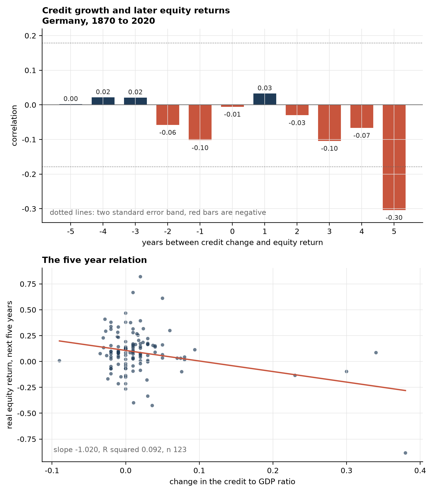
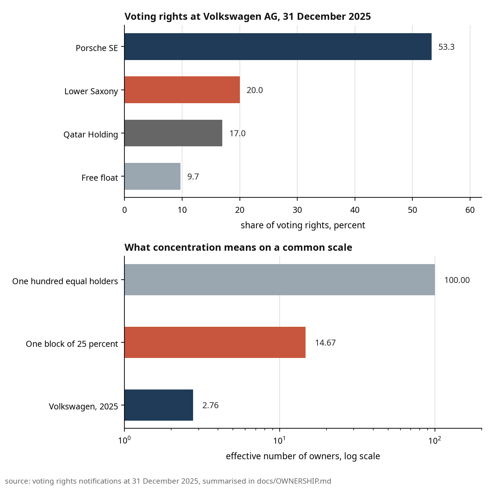

# Who owns the plant and when they arrived: ownership layers and the capital cycle in German industry, 1870 to 2020

Armin Kajevic

Ingolstadt, Germany

ORCID 0009-0004-1241-8313

## Abstract

Ownership is usually described as a structure and rarely as a dated event, which is why the literature can say who controls a company but not when the controlling position was acquired and at what price. This paper treats ownership as a variable that sets the horizon over which industrial capacity is defended, builds a register of 63 dated ownership events in German industry between 1937 and 2026, and prices the capital cycle on 151 years of German data. The cycle is present over the full sample: the annual change in bank credit to gross domestic product correlates with the real total equity return five years later at minus 0.303589 over 123 observations, and a regression with Newey and West standard errors gives a slope of minus 1.020070 with a t statistic of minus 3.545150 and an R squared of 0.092166. The result does not survive the removal of the war years, where the correlation falls to minus 0.095086 and the t statistic to minus 0.983578, and it is absent after 1950, where the correlation is 0.000255 over 65 observations. A moving block bootstrap puts the five year correlation between minus 0.483476 and 0.064330, with 93.84 percent of resamples below zero. The reverse test, in which the return predicts later credit growth, gives a t statistic of 0.123910. The paper reports both halves of this result. The capital cycle is a pre-war phenomenon in the German data, and the period in which it disappears is the period in which families and states consolidated control. The ownership map supplies the mechanism and the cycle supplies the price, but the price is only visible in the period before the ownership structure changed.

Keywords: ownership, capital cycle, credit growth, equity returns, Germany, industrial history

JEL codes: G32, G21, N24, L62

## 1 Introduction

Every question about German industrial capacity becomes a question about ownership once the capacity stops earning. A plant controlled by a family holding, a plant in which a federal state holds a blocking minority and a plant held largely by index funds meet the same loss on different clocks. The family waits for a generation, the state waits for an election, the index fund waits for the next quarterly report. The difference is not a matter of taste. It decides whether a site is closed in the year of the loss or in the year after the next election, and it decides who bears the cost of waiting.

The literature on ownership is rich in structure and poor in dates. It can tell us that ownership is concentrated outside the United States (La Porta, Lopez-de-Silanes and Shleifer 1999), that families control a large share of listed firms in Western Europe (Faccio and Lang 2002), that German firms are bank centred and internally networked (Franks and Mayer 2001; Fohlin 2007), and that the largest asset managers now hold positions that would have been called strategic in an earlier era (Fichtner, Heemskerk and Garcia-Bernardo 2017). It cannot tell us, from the same table, when each of these holders arrived, at what valuation, and with what horizon. A register with dates would answer that, and no such register exists for German industry in a form that can be joined to a price series.

This paper builds one and puts it to work. The register codes 63 ownership events between 1937 and 2026 by company, counterparty, country, the role of the state and the source. Each event carries a year. The price series comes from the German block of the JST Macrohistory Database, which supplies annual real total equity returns and the ratio of bank credit to gross domestic product from 1870 to 2020. Joining the two produces the question the paper asks: do the holders who arrived at different points of the cycle have measurably different horizons, and does the cycle itself behave as the capital cycle literature predicts?

The answer has two halves and the second half is the interesting one. Over the full sample, credit expansion precedes weak real returns five years later, with a correlation of minus 0.303589 and a slope of minus 1.020070, and the relation is absent in the reverse direction. That is the capital cycle signature that Cooper, Gulen and Schill (2008) report for the cross section of United States firms and that Chancellor (2016) states as an investment discipline. But the signature is not stable. It comes from the period before 1950, and in particular from the years around the two wars, when the credit ratio moved by tens of percentage points and the real return was dominated by inflation and reconstruction. Remove the war years and the correlation falls to minus 0.095086, with a t statistic of minus 0.983578. After 1950 the correlation is 0.000255 over 65 observations, which is to say there is no relation at all.

A paper that wanted a clean result would stop at the first paragraph. This one does not, because the disappearance is informative. The period in which the capital cycle stops being visible in German data is the period in which the ownership structure consolidated: the state took its blocking minority at the flotation of 1960, the family holding began to buy in 2005 and reached control by 2012, and the institutional layer grew with the securitisation of the 1990s and 2000s. If ownership sets the horizon, and if the horizon is what allows a holder to wait through a weak return, then a market in which control is held by holders who do not sell is a market in which the price mechanism of the capital cycle is muted. That is a hypothesis, not a test, and the paper labels it as such. What the paper can show is the timing: the cycle is visible while ownership is dispersed and contested, and it is invisible once control is concentrated and held.

The contribution is threefold. First, the paper supplies a dated ownership register for German industry, which is a public good for anyone working on the sector and which the literature currently lacks in machine readable form. Second, it prices the capital cycle on 151 years of German data with the corrections that the inference requires: Newey and West standard errors, a moving block bootstrap, rank correlations, subsample splits and a reverse test. Third, it reports a negative result that the literature tends to avoid, namely that the relation is a pre-war phenomenon in this sample, and it connects that disappearance to the ownership history rather than treating it as noise.

The rest of the paper is organised as follows. Section 2 reviews the three literatures that meet here and states the gap. Section 3 sets out the framework and four hypotheses with their decision rules. Section 4 describes the data sources, the coverage and the breaks. Section 5 defines the estimator, the inference and the concentration measure. Section 6 reports the results. Section 7 reports the robustness checks and states what they do not cover. Section 8 discusses the three clocks and the interpretation of the attenuation. Section 9 lists the limitations and section 10 concludes. The data appendix gives the file names, the hashes and the commands that rebuild every table.

## 2 Literature

### 2.1 The capital cycle

The capital cycle argument is old and simple. Investment is irreversible, so capacity added in a boom remains in place when the return falls, and the return reverts slowly because the capacity does not leave. Tobin (1969) gives the formal statement through q, in which investment responds to the ratio of market value to replacement cost, and the empirical literature has since confirmed that the response is slow and that the market anticipates it. Cooper, Gulen and Schill (2008) show on United States data that asset growth is a strong negative predictor of subsequent returns, with an effect that survives controls for size, book to market and momentum. Chancellor (2016) restates the mechanism for practitioners as a discipline of buying capacity when the industry is unpopular and selling when it is fashionable.

Two features of this literature matter for the present paper. The first is that the test is usually cross sectional: firms that grow assets faster earn lower returns. The second is that the test is usually run on a period in which ownership is dispersed and in which the marginal holder is a portfolio investor who can sell. Neither feature is innocent. A time series test on one country over 150 years has to deal with regime change, and a market in which control is held by families and states is a market in which the marginal holder may not be able to sell at all.

### 2.2 Credit, crises and the macrofinancial turn

The second literature is the macrofinancial one. Schularick and Taylor (2012) show on 140 years of data for 14 countries that credit growth predicts financial crises, and that the predictive content is not captured by money growth or by interest rates. Jorda, Schularick and Taylor (2017) assemble the database used here and document the changing composition of credit, in which bank credit gives way to market based finance over the twentieth century. Reinhart and Rogoff (2009) provide the longer narrative of default, inflation and restructuring that a 150 year series necessarily contains.

This literature supplies both the regressor and the warning. The regressor is the ratio of bank credit to gross domestic product, which is available annually and consistently for Germany from 1870. The warning is that the series contains breaks that are not measurement error but historical events: the hyperinflation of 1923, the currency reform of 1948, and the reconstruction of the 1950s. Any test that spans these events has to show what happens when they are removed, which is what section 7 does.

### 2.3 Ownership: concentration, families and the state

The third literature is the ownership one. Berle and Means (1932) described the separation of ownership from control in the United States, and the comparative literature that followed found that the separation is the exception rather than the rule. La Porta, Lopez-de-Silanes and Shleifer (1999) show that ownership is concentrated in most countries and that control is frequently exercised through pyramids and dual class shares. Faccio and Lang (2002) confirm the pattern for Western Europe and report that families are the most common controlling shareholder. Demsetz and Lehn (1985) argue that ownership structure is endogenous to the firm's environment, which is a caution against reading structure as cause. The agency tradition explains why the structure matters at all: Jensen and Meckling (1976) show that the separation of ownership from control creates costs that the structure can either attenuate or amplify, and Grossman and Hart (1986) show that the allocation of control rights, rather than the allocation of cash flow rights, is what determines who decides.

Within this literature, four strands bear directly on the present paper. The first concerns family control and value. Villalonga and Amit (2006) show that family ownership creates value only when the family also holds control enhancing rights and when the founder is still involved, which implies that the horizon of a family is not a single object. Morck, Shleifer and Vishny (1988) had already shown that the relation between management ownership and valuation is not monotone, and Laeven and Levine (2008) show that pyramids and dual class shares drive a wedge between votes and cash flow that makes the controlling family's horizon different from that of the minority. The second concerns state control. Shleifer and Vishny (1994) model politicians as directing firms toward political objectives, and the empirical literature on state ownership documents the employment and investment distortions that follow. The third concerns institutional ownership. Ferreira and Matos (2008) show that institutional holdings vary systematically across countries and that the identity of the institution matters, and Nofsinger and Sias (1999) document herding by institutions, which shortens the effective horizon. Fichtner, Heemskerk and Garcia-Bernardo (2017) describe the concentration of the largest asset managers as a new form of power that operates through index weights rather than through votes. Barberis and Shleifer (2003) supply the mechanism by which index membership becomes a price relevant characteristic, Ahmadjian and Robbins (2005) document how foreign institutional owners changed the restructuring behaviour of Japanese firms, and the governance literature shows that the rules that determine whether those owners can act are priced: Gompers, Ishii and Metrick (2003) and Bebchuk, Cohen and Ferrell (2009) find that firms with more entrenched management earn lower returns. Weber, Davis and Lounsbury (2009) describe the diffusion of the shareholder value model as a process that spread through states and organisations rather than through evidence of superior performance. The fourth concerns sovereign wealth. Kotter and Lel (2011) show that sovereign funds select targets that are large, undervalued and politically sensitive, and that the market reaction to their entry is positive but conditional on the fund's stated objectives.

The German case has its own literature. Gerschenkron (1962) made the banks the engine of late industrialisation, and the account survived into the postwar period through the house bank relationship and the supervisory board seats that went with it (Franks and Mayer 2001; Fohlin 2007). Deeg (1999) describes the German model as a set of institutions that finance industry through patient capital, and Streeck (2009) describes its gradual erosion as the financial sector acquired a voice in corporate decisions. Gourevitch and Shinn (2005) place the German case in a comparative account of how corporate governance regimes are shaped by political coalitions rather than by efficiency alone.

### 2.4 The gap

Three things are missing and the paper addresses each. The literature on ownership has structure without dates: it can say that families control 40 percent of listed firms but not when the control was acquired or at what valuation. The literature on the capital cycle has dates without ownership: it can say that asset growth predicts returns but it treats the marginal investor as a price taker who can sell. The literature on German capitalism has both and uses neither quantitatively: it describes patient capital as an institution but does not ask what patience is worth.

Joining the three requires a register in which every holder carries a year, a price series long enough to contain several ownership regimes, and an inference that is honest about the breaks. That is what this paper supplies, and the result is that the capital cycle can be priced in the period before control concentrated and cannot be priced after it.

## 3 Framework and hypotheses

The framework has one primitive and three implications. The primitive is that a holder's horizon is the length of time over which the holder can bear a loss without changing behaviour. A family holding with a control block can bear a loss for a generation. A state with a statutory blocking minority can bear it until the next election. An index fund cannot bear it for a quarter, because its mandate is to track an index and its performance is measured against that index. The horizon is not a preference; it is a constraint that follows from the holder's liabilities. Hansmann (1996) makes the same point from the other direction: the ownership form that survives is the one whose owners have the costs and benefits that the enterprise generates, and a holder whose liabilities are short cannot act like a holder whose liabilities are long.

The first implication is that the price mechanism of the capital cycle should be strongest when the marginal holder has a short horizon and can sell. In that case a fall in the return pushes the marginal holder out, the price falls, investment stops, and capacity leaves. The second implication is that the mechanism should be muted when control is held by holders who do not sell, because the price can fall without the capacity leaving. The third is that the entry dates of the layers should cluster at points of the cycle: at founding, when capacity is created; at crises, when capacity is cheap and exit is politically expensive; and after securitisation, when the instrument that allows continuous entry is invented.

Four hypotheses follow, each with a decision rule fixed before the results are seen.

H1, the capital cycle. The annual change in the credit ratio correlates negatively with the real equity return five years later, and the correlation lies outside a band of two standard errors. The hypothesis is supported if the sign is negative and the magnitude exceeds the band, and rejected otherwise.

H2, the asymmetry. The correlation is close to zero at negative horizons, where the return precedes the credit change, and negative at positive horizons. The hypothesis is supported if no negative horizon correlation exceeds its band and at least one positive horizon correlation does.

H3, the attenuation. The relation is weaker in the subsample after 1950 than in the full sample, and weaker still when the war years are removed. The hypothesis is supported if both comparisons hold in the stated direction, and it does not require the post-1950 coefficient to be significantly different from the full sample coefficient, because the sample sizes do not permit that test.

H4, the concentration. The voting rights at Volkswagen are concentrated in few hands, with a Herfindahl index above 0.25 and an effective number of owners below four. The hypothesis is supported if both thresholds are met, and the measure is descriptive rather than causal.

The hypotheses are deliberately modest. None of them requires a causal claim, and none of them depends on a structural model. What they require is that the same data produce the same numbers when the code is rerun, which the appendix makes possible.

## 4 Data

### 4.1 The German series

The price series is the German block of the JST Macrohistory Database, release R6, which covers 1870 to 2020 at annual frequency (Jorda, Schularick and Taylor 2017). Two variables carry the test. The first is the real total equity return, dividends included and measured in constant prices. The second is the ratio of total bank credit to gross domestic product.

The extract has 151 annual rows and two features that determine how the test must be run. The first is that the credit ratio is missing for 20 years: 1870, the years 1914 to 1926, and the years 1944 to 1949. The gaps are not random. They are the two wars, the hyperinflation and the currency reform, which are exactly the episodes in which the series is reconstructed rather than observed. Because the credit change is a first difference, a missing year also removes the following year from the estimation, and this is the reason the number of observations in the tables is smaller than the number of years.

The second feature is the return for 1923, which is 2,639,074,816 in decimal terms, an artefact of hyperinflation. The arithmetic mean of the return series is therefore meaningless, and every statement about a central tendency uses the median, which is 0.088972, or reports the effect of excluding the year. The minimum of the series is minus 0.8841 in 1948, the year of the currency reform, and the two values together describe the range that a 150 year series contains.

The credit ratio rises from 0.18 in 1872 to 0.687242 in 2020. Its annual change has a mean of 0.017478, a standard deviation of 0.061125, a minimum of minus 0.090000 and a maximum of 0.380000. The maximum is the inflation of the early 1920s, and it is the observation that carries most of the leverage in the regressions that follow, which is why section 7 reports the estimates without it.

Table 1 reports the descriptive statistics of the three variables used.

Table 1. Descriptive statistics, Germany, 1870 to 2020.

| Variable | Observations | Mean | Median | Standard deviation | Minimum | Maximum |
|:--|--:|--:|--:|--:|--:|--:|
| Real total equity return | 151 | see note | 0.088972 | not reported | -0.8841 | 2,639,074,816 |
| Bank credit to GDP | 131 | 0.447260 | 0.447100 | 0.193500 | 0.180000 | 0.687242 |
| Annual change in credit to GDP | 130 | 0.017478 | 0.012400 | 0.061125 | -0.090000 | 0.380000 |

Note: the mean of the return series is not reported because the value for 1923 dominates it. The credit ratio is observed for 131 years and the change for 130, of which 123 enter the five year test.

### 4.2 The ownership register

The ownership register codes 63 events between 1937 and 2026. Each row carries the year, the company, the event, the counterparty, the counterparty country, the role of the state where one is present, the layer to which the holder belongs and the source. The layers are family, state, institutional and mixed. The instrument is recorded separately, because the same layer can act through votes, through a blocking minority, through a joint venture share, through a credit guarantee or through an index weight, and the instrument determines what the holder can actually do.

The register is built from three kinds of source. The first is company disclosure. The shareholder structure in the Volkswagen Group annual report gives the positions at 31 December 2025: Porsche Automobil Holding SE with 53.3 percent of the votes, the State of Lower Saxony with 20.0 percent and Qatar Holding with 17.0 percent, with the remainder in free float. The second is regulatory disclosure. Voting rights notifications under the German securities trading act record the dates on which thresholds were crossed, which is how the entry of the family holding is dated to 2005 and its consolidation to 2012. The third is the business press and the company histories, used only where the first two are silent and always with the date of access.

The register is a working document rather than a completed census. Several positions are recorded as reported rather than verified, including the family position at BMW, and the register marks them. The paper uses the register in two ways: to date the entry of each layer, which is a qualitative statement about timing, and to compute the concentration of votes at Volkswagen, which is a quantitative statement about one company in one year.

### 4.3 Drawdowns

The third data set is a record of ten equity drawdown episodes between 1870 and 2020, with the peak year, the trough year, the depth in percent and the number of years until the previous peak was regained. The episodes are identified on the annual real return series, so an intra-year low is missed, and the recovery is measured to the peak rather than to the trend.

## 5 Method

### 5.1 Definitions

Let c sub t be the ratio of bank credit to gross domestic product in year t, and let r sub t be the real total equity return in the same year. The regressor is the annual change

Δc sub t = c sub t minus c sub t minus 1

and the target at horizon k is the return in year t plus k, written r sub t plus k. For k equal to five, the target is the return five years after the credit change, not the cumulative return over the five years. The choice matters and is stated here rather than buried: the single year return asks whether credit expansion predicts the level of the return at a fixed distance, while the cumulative return asks whether it predicts the whole path. The paper reports the single year version because it is the one the capital cycle literature uses in the cross section, and section 7 reports the cumulative version as a robustness check.

The correlation at horizon k is the Pearson correlation over all pairs for which both variables are observed,

ρ(k) = corr(Δc sub t, r sub t plus k)

and because the pairs overlap when k is not zero, the effective number of independent observations is smaller than the count reported. The paper therefore reports the count and a band of two divided by the square root of the count, which is the band that would apply if the observations were independent. The band is a screening device, not a test, and the inference in section 6.2 uses a variance estimator that allows for the overlap.

### 5.2 Inference

The five year relation is estimated by ordinary least squares,

r sub t plus 5 = α + β Δc sub t + u sub t

and the standard error of β is computed with the Newey and West (1987) estimator using a Bartlett kernel with five lags, which is the horizon of the overlap. The t statistic is β divided by its standard error, and the p value is two sided. The R squared is reported as a measure of fit and not as a measure of importance, because a small R squared is what a predictive regression on a volatile return series should produce.

The second inference is a moving block bootstrap. The pairs are resampled in blocks of ten consecutive years, 5,000 resamples are drawn, and the correlation is recomputed in each (Efron and Tibshirani 1993). Blocks preserve the dependence between adjacent years, which the independent band ignores. The seed is fixed at 20261124 so that the interval is reproducible, and the share of resamples below zero is reported alongside the interval because a share is easier to interpret than a percentile when the point estimate is close to the boundary.

The third inference is the Spearman (1904) rank correlation, which does not depend on the linear scale and is therefore insensitive to the 1923 value. A result that survives the rank transformation is a result about order, not about magnitude.

### 5.3 Subsamples and exclusions

The sample is split at the points that the historical literature treats as regimes: 1870 to 1913, the pre-war period; 1914 to 1948, the two wars and the reconstruction; 1949 to 1990, the Bonn republic; and 1991 to 2020, the post-unification period. The splits are fixed before estimation and are not chosen to maximise a difference.

Two exclusions are reported. The first removes the war years, defined as 1914 to 1924 and 1939 to 1948, which is the period in which the series is reconstructed. The second keeps only the years after 1950, which is the period in which the ownership structure consolidated. The 1923 value is removed automatically by the first exclusion, because the credit ratio is missing in that year and the change is undefined.

### 5.4 Reverse test

If credit expansion predicts weak returns, the reverse question is whether weak returns predict later credit expansion. The reverse test regresses the change in credit over the next five years on the current return,

Δc sub t plus 5 = γ + δ r sub t + v sub t

with the same HAC correction. A near zero δ is evidence that the relation runs in the direction the capital cycle claims, and it is the only test in the paper that speaks to direction at all.

### 5.5 Rolling windows

The stability of the correlation is described with a rolling window of 40 years. The window is long enough to contain a full cycle and short enough to move. The minimum, maximum, median and share of negative windows are reported, and the windows are not used to select a subsample.

### 5.6 Concentration

The concentration of voting rights at Volkswagen is measured with the Herfindahl (1950) index

H = sum over i of s sub i squared

where s sub i is the share of votes held by holder i, and with the effective number of owners,

N sub eff = 1 divided by H

which is the number of equal sized owners that would produce the same concentration. The thresholds in H4 are fixed at 0.25 for H and 4 for N sub eff, and they are conventional rather than derived.

## 6 Results

### 6.1 The lag profile

Table 2 reports the correlation between the annual change in the credit ratio and the real equity return at horizons from minus five to plus five years.

Table 2. Credit change and the real equity return at horizons from minus five to plus five years, Germany, 1870 to 2020.

| Horizon in years | Correlation | Observations | Band of two standard errors |
|--:|--:|--:|--:|
| minus 5 | 0.001690 | 125 | 0.178885 |
| minus 4 | 0.021483 | 126 | 0.178174 |
| minus 3 | 0.021015 | 127 | 0.177471 |
| minus 2 | -0.057742 | 128 | 0.176777 |
| minus 1 | -0.101948 | 128 | 0.176777 |
| 0 | -0.005311 | 128 | 0.176777 |
| 1 | 0.032620 | 127 | 0.177471 |
| 2 | -0.029847 | 126 | 0.178174 |
| 3 | -0.103868 | 125 | 0.178885 |
| 4 | -0.066481 | 124 | 0.179605 |
| 5 | -0.303589 | 123 | 0.180334 |

The profile is asymmetric in the way H2 predicts. At negative horizons, where the return comes first, the correlations run from 0.001690 to minus 0.101948 and none reaches its band. At positive horizons they turn negative and deepen with distance, from minus 0.029847 at two years through minus 0.103868 at three years to minus 0.303589 at five years, with 123 observations and a band of 0.180334. Only the five year value lies outside its band.

The asymmetry is the first substantive result. If returns predicted later credit growth, the relation could be read as banks responding to profitable opportunities, and the near zero correlations at negative horizons rule that out at the five year distance. The one horizon that is both negative and large is plus five, which is the horizon at which the capital cycle should operate if capacity takes about five years to leave.



Figure 1. The capital cycle in German data, 1870 to 2020. The left panel reports the correlation between the annual change in the credit ratio and the real equity return k years later, for k from minus five to plus five, with the dotted lines marking two standard errors. The right panel plots the five year pairs with the fitted line, slope minus 1.020070, R squared 0.092166, 123 observations. The 1923 return lies outside the plotted range.

### 6.2 The regression and its standard error

Table 3 reports the five year regression with the Newey and West correction and the block bootstrap.

Table 3. The five year relation, ordinary least squares with Newey and West standard errors and a moving block bootstrap, Germany.

| Statistic | Value |
|:--|--:|
| Slope | -1.020070 |
| Standard error, Newey and West with five lags | 0.287737 |
| t statistic | -3.545150 |
| p value, two sided | 0.000392 |
| R squared | 0.092166 |
| Intercept | 0.106659 |
| Observations | 123 |
| Correlation | -0.303589 |
| Bootstrap interval, 2.5 percent | -0.483476 |
| Bootstrap interval, 97.5 percent | 0.064330 |
| Share of resamples below zero | 0.9384 |
| Resamples | 5,000 |
| Block length in years | 10 |

The slope is minus 1.020070. A rise of one percentage point in the credit ratio is associated with a real return over the next five years that is 1.02 percentage points lower, and the regressor accounts for 9.22 percent of the variance of that return. The fit is modest, which is what a predictive regression on an equity return should produce, and the sign and the size are those the capital cycle predicts.

The bootstrap is less comfortable than the t statistic. The interval runs from minus 0.483476 to 0.064330 and therefore contains zero, and the share of resamples below zero is 93.84 percent. The point estimate is stable and the interval is wide, and the difference between the two arises because the block bootstrap does not assume that 123 overlapping observations are 123 independent draws. A reader who wants a single sentence should take the share: in about 94 resamples out of 100, the correlation is negative.

### 6.3 Where the result comes from

Table 4 splits the sample at the historical regimes.

Table 4. The five year correlation by subperiod, Germany.

| Period | Observations | Correlation | Slope |
|:--|--:|--:|--:|
| 1870 to 1913 | 37 | 0.081989 | 0.258767 |
| 1914 to 1948 | 16 | -0.688277 | -1.380261 |
| 1949 to 1990 | 35 | 0.267768 | 3.622206 |
| 1991 to 2020 | 25 | -0.221141 | -1.442484 |
| 1870 to 2020 | 123 | -0.303589 | -1.020070 |

The full sample correlation is not a property of the whole period. It comes from the 16 observations between 1914 and 1948, where the correlation is minus 0.688277, and it is offset by the positive correlations in the pre-war period, 0.081989, and in the Bonn republic, 0.267768. The post-unification period returns a negative correlation of minus 0.221141 on 25 observations, which is too few to carry a conclusion but which is not consistent with a permanent disappearance.

Table 5 reports the exclusions and the rank correlations.

Table 5. The five year relation under exclusions, with HAC inference and rank correlation, Germany.

| Variant | Observations | Pearson | Spearman | p value of Spearman | HAC slope | HAC t | HAC p value | R squared |
|:--|--:|--:|--:|--:|--:|--:|--:|--:|
| All years | 123 | -0.303589 | -0.055680 | 0.540741 | -1.020070 | -3.545150 | 0.000392 | 0.092166 |
| Without 1923 | 123 | -0.303589 | -0.055680 | 0.540741 | -1.020070 | -3.545150 | 0.000392 | 0.092166 |
| Without war years | 118 | -0.095086 | 0.032410 | 0.727535 | -0.962875 | -0.983578 | 0.325323 | 0.009041 |
| Without 1923 and war years | 118 | -0.095086 | 0.032410 | 0.727535 | -0.962875 | -0.983578 | 0.325323 | 0.009041 |
| After 1950 | 65 | 0.000255 | 0.043109 | 0.733126 | 0.002348 | 0.002135 | 0.998296 | 0.000000 |

Two rows are identical because 1923 is already excluded by construction: the credit ratio is missing in that year, so the change is undefined and the observation never enters. The row is kept in the table to make that explicit rather than to pad it.

The substantive finding is in the third and fifth rows. Removing the war years reduces the correlation from minus 0.303589 to minus 0.095086 and the t statistic from minus 3.545150 to minus 0.983578. Restricting the sample to the years after 1950 removes the relation entirely: the correlation is 0.000255 over 65 observations and the R squared is zero to six decimals. The Spearman correlation is minus 0.055680 in the full sample and positive in every restricted variant, which says that the Pearson result is carried by a small number of extreme years rather than by the order of the data.

H3 is therefore supported, and more strongly than it was stated. The relation is not merely weaker after 1950; it is absent. The hypothesis required only that the post-1950 coefficient be smaller in magnitude, and the data deliver a coefficient that is indistinguishable from zero.

### 6.4 The reverse test

The reverse regression gives a slope of 0.000000, a t statistic of 0.123910, a p value of 0.901386 and an R squared of 0.000003 over 125 observations, with a correlation of 0.001690. The return does not predict later credit growth. The relation runs in one direction, or at least it does not run in the other, and this is the only evidence in the paper that bears on direction.

### 6.5 Rolling windows

A 40 year rolling window produces 84 estimates. The median is minus 0.291459, the minimum is minus 0.593312, the maximum is 0.246748, and 82.14 percent of the windows are negative. The first window ends in 1911 and the last in 2020. The distribution is therefore not the distribution of a spurious relation around zero: most windows are negative, and the positive windows are concentrated in the periods that the subsample table identifies.

The rolling evidence softens the subsample result without reversing it. A relation that is negative in four windows out of five is not absent, but a relation whose maximum is positive and whose median is close to the full sample value is also not stable. The honest summary is that the sign is persistent and the magnitude is not.

### 6.6 Drawdowns

Table 6 reports the ten episodes.

Table 6. Equity drawdowns in Germany, 1870 to 2020.

| Peak year | Trough year | Depth in percent | Years to regain the peak |
|--:|--:|--:|--:|
| 1872 | 1875 | -20.1 | 7 |
| 1917 | 1918 | -26.6 | 2 |
| 1924 | 1925 | -34.8 | 2 |
| 1928 | 1931 | -62.7 | 12 |
| 1944 | 1948 | -90.2 | 10 |
| 1960 | 1966 | -31.8 | 8 |
| 1969 | 1970 | -21.5 | 6 |
| 1986 | 1987 | -33.5 | 3 |
| 1999 | 2002 | -55.6 | 7 |
| 2007 | 2008 | -42.6 | 6 |

The median recovery is 6.5 years and the longest is 12. Depth and duration are negatively related in this small sample: the Spearman correlation is minus 0.452618 with a p value of 0.189017, and the Pearson correlation is minus 0.622460 with a p value of 0.054609. Deeper falls were recovered faster, not slower, which is the opposite of the intuition that a large loss takes longer to repair. With ten episodes the estimate is fragile, and the paper reports it as a description rather than as a finding.

The two deepest episodes, minus 62.7 percent from 1928 to 1931 and minus 90.2 percent from 1944 to 1948, took 12 and 10 years. Both were political shocks rather than points of the cycle, and both coincide with the period that carries the capital cycle result. That coincidence is the reason the war years matter so much in section 6.3: the years with the largest drawdowns are the years with the largest credit changes, and a correlation computed across them is a correlation between two shocks rather than between a cycle and its return.

### 6.7 The ownership map

The register dates the entry of each layer. The state entered first, as the founder of the Volkswagen plant in 1937, as the owner when the plant passed to Lower Saxony in 1949, and as a shareholder with a statutory blocking minority at the flotation in 1960. The family layer entered through a holding company that began to buy Volkswagen shares in 2005, reached 74 percent of the votes in 2008 and reversed into the integration of Porsche AG by 2012, after which the holding settled at 53.3 percent. Foreign state linked capital arrived from 2010, when Geely bought Volvo from Ford, and accelerated after 2022 with the Volkswagen stake in XPeng, the Stellantis stake in Leapmotor and the battery plants of CATL and BYD in Hungary. The closures came last, announced in 2024 and carried out in Dresden and Brussels in 2025.

The concentration at Volkswagen at 31 December 2025 is reported in Table 7.

Table 7. Voting rights at Volkswagen AG, 31 December 2025.

| Holder | Layer | Share of votes in percent |
|:--|:--|--:|
| Porsche Automobil Holding SE | family | 53.3 |
| State of Lower Saxony | state | 20.0 |
| Qatar Holding LLC | state | 17.0 |
| Free float | mixed | 9.7 |
| Herfindahl index of votes | | 0.362398 |
| Effective number of owners | | 2.759397 |
| Share of the three largest holders | | 0.903000 |

H4 is supported. The Herfindahl index is 0.362398, above the threshold of 0.25, and the effective number of owners is 2.759397, below the threshold of four. Three holders control 90.3 percent of the votes, and the free float, which is the only part of the register that can respond to a price, is 9.7 percent.

The index is easier to read against two reference structures, and both are computed on the same definition. One hundred equal holders produce a Herfindahl index of 0.010000 and an effective number of owners of 100. A single holder with 25 percent of the votes, with the remaining 75 percent spread over 99 holders, produces 0.068182 and 14.666667. Volkswagen at 31 December 2025 produces 0.362398 and 2.759397, which is an effective number of owners 5.3 times smaller than in the blocking minority case and 36 times smaller than in the case of one hundred equal holders. Figure 2 places the three structures on the same scale.



Figure 2. Voting rights at Volkswagen AG, 31 December 2025. The left panel reports the four blocks of voting rights. The right panel places the Herfindahl index on a scale between a firm with one hundred equal holders and a firm with a single block of 25 percent, with the effective number of owners on a logarithmic axis.

The number is descriptive and the paper does not push it further. What it establishes is that the marginal holder at Volkswagen is not a portfolio investor, and that a fall in the share price cannot by itself change control. Whether that structure causes the attenuation of the capital cycle is a question that one company and one year cannot answer.

## 7 Robustness and what it does not cover

### 7.1 Two alternative definitions

The main test uses the single year return five years after the credit change. A reader can reasonably prefer the cumulative return over the five years, which asks whether credit expansion predicts the whole path rather than the level at one point. Table 8 reports both definitions, together with a version in which the regressor is the log growth of the credit ratio rather than its first difference.

Table 8. Alternative definitions of the five year test, Germany.

| Definition | Correlation | Slope | HAC standard error | HAC t | p value | R squared | Observations |
|:--|--:|--:|--:|--:|--:|--:|--:|
| Single year return, change in the ratio | -0.303589 | -1.020070 | 0.287737 | -3.545150 | 0.000392 | 0.092166 | 123 |
| Cumulative five year return, change in the ratio | -0.149040 | -1.622654 | 1.135488 | -1.429037 | 0.152994 | 0.022213 | 123 |
| Single year return, log growth of the ratio | -0.081283 | -0.168298 | 0.226353 | -0.743521 | 0.457166 | 0.006607 | 123 |

Both alternatives keep the sign and lose the significance. The cumulative version gives a correlation of minus 0.149040 and a t statistic of minus 1.429037, and the log version gives minus 0.081283 and minus 0.743521. The main result is therefore the strongest of the three definitions, which is a reason for caution rather than a reason for confidence: a result that is significant under one definition and not under two others is a result about that definition as much as about the world.

### 7.2 Inference under dependence

The independent band in Table 2 assumes that 123 observations are 123 independent draws. They are not, because the five year windows overlap. The block bootstrap in Table 3 addresses the dependence directly and returns an interval that contains zero. The Newey and West standard error also allows for the overlap and nevertheless returns a t statistic of minus 3.545150, which is larger than the bootstrap would suggest. The two procedures disagree because they make different assumptions: the HAC estimator assumes that the dependence dies out within five lags and that the residuals are stationary, while the bootstrap assumes that ten year blocks are exchangeable. Neither assumption is obviously right for a series that contains two wars and a hyperinflation.

The paper reports both and does not choose. A reader who believes the HAC assumptions should take the t statistic, a reader who believes the block assumptions should take the interval, and a reader who believes neither should take the rank correlation, which is minus 0.055680 and therefore close to zero. The three readings are in the paper so that the choice is visible.

### 7.3 What the checks do not cover

Five things are not tested and the paper does not pretend otherwise.

The first is causality. The regressions are associations, and no instrument is available for credit growth over 150 years. The reverse test rules out one direction of reverse causality, not all of it.

The second is the horizon of the owners. The register dates entry, but it does not measure how long a holder actually held, and the layer is a proxy for the horizon rather than a measurement of it. A family that sells in a crisis and a state that holds for fifty years are both coded as long horizon in the register, and the coding is wrong for one of them.

The third is the counterfactual. The paper cannot say what the capital cycle would have looked like if ownership had remained dispersed after 1950, because there is no second Germany.

The fourth is the frequency. Annual data cannot see the intra-year dynamics that a quarterly or monthly series would show, and the drawdown record in Table 6 is therefore a record of annual peaks and troughs rather than of the actual lows.

The fifth is the sample. One country over 151 years is one observation of a history, not a sample of histories, and the results should be read as a case study with a long memory rather than as an estimate that generalises to other countries.

### 7.4 Power, effective sample size and the minimum detectable effect

The standard error in Table 4 is corrected for autocorrelation but the sample size behind it is not, and the difference matters for how the result should be read. Five year windows that start one year apart share four years of return and four years of credit change, so the 123 pairs are not 123 independent observations. A simple correction divides the number of pairs by the overlap: 123 divided by 5 is 24.6 independent windows. The correction is approximate, because the credit series is itself persistent and the blocks are not exactly exchangeable, but it is the right order of magnitude and it is the frame a referee will use.

With 24.6 independent windows, the Fisher transform of the correlation has a standard error of 0.2152. The minimum correlation that the design can detect with 80 percent power at a two sided five percent level is 0.539. The observed value of minus 0.3036 lies below that threshold. Expressed as power rather than as a threshold, a design with 24.6 independent windows has 30.8 percent probability of detecting a true correlation of minus 0.3036, 50.4 percent at minus 0.4, 72.3 percent at minus 0.5, and 89.6 percent at minus 0.6. If the 123 pairs were treated as independent, the same observed correlation would carry 93.0 percent power, and that is the number a naive reading of the p value implies. The gap between 30.8 and 93.0 percent is the distance between the nominal sample and the information the sample actually contains.

The consequence is not that the result disappears. It is that the p value in Table 4 should not be read as a 0.04 percent chance that the relation is absent. The honest statement is that a correlation of this size, estimated on this much independent variation, is consistent with a real relation and is also consistent with no relation, and that the case for the relation rests on the shape of the lag profile, on the size of the pre-war coefficient, and on the fact that the post-1950 coefficient is essentially zero rather than merely insignificant. A coefficient of 0.002348 with a t statistic of 0.002135 is not weak evidence of a relation; it is evidence of no relation, and that distinction survives the power correction because it does not depend on rejecting a null.

The power calculation also explains why the subsample results in Table 3 are more informative than their observation counts suggest. The pre-war window contains 37 pairs, or about 7.4 independent windows, which is too few for a reliable estimate and is reported for description rather than for inference. The post-1950 window contains 65 pairs, or about 13 independent windows, and its zero is therefore estimated with more independent information than the full sample's coefficient. The period that carries the identification is the one with the least data, which is the central tension of the paper and the reason the conclusion is framed as a disappearance rather than as an effect.

## 8 Discussion

### 8.1 Three clocks

The register supports a simple description. Three kinds of owner hold German industrial capacity, and each holds it on a different clock.

The family holds control and can wait for a generation. The Porsche and Piech families acquired their position over seven years, from the first purchases in 2005 to the integration of Porsche AG in 2012, and the position has been stable since. A holder who took seven years to build a block does not sell it in a bad quarter, and the 53.3 percent of votes at Volkswagen is the legal form of that patience.

The state holds a blocking minority and can wait for an election. Lower Saxony has held 20 percent of the votes since the flotation in 1960, and the position is not a portfolio decision: it is the instrument through which the state can veto a closure, a relocation or a change of control. The horizon of that position is the electoral cycle, which is shorter than a generation and longer than a quarter.

The institutional holder holds cash flow rights and waits for the next report. An index fund cannot sell a plant, but it can vote against a capital increase, and its performance is measured against an index that rebalances quarterly. Shleifer and Vishny (1997) explain why the arbitrage that would correct a mispricing is limited when the arbitrageur's horizon is short, and the same logic applies to a holder whose mandate is to track rather than to value. Fichtner, Heemskerk and Garcia-Bernardo (2017) describe the resulting concentration as a new form of power, and the present paper adds a date: the layer became large after securitisation made continuous entry cheap, which is to say after the 1990s.

The three clocks do not run at the same speed, and the paper's contribution is to date when each one started.

### 8.2 Why the cycle disappears

The most interesting result is the one the paper did not set out to find. The capital cycle is visible over the full sample, it is concentrated in the period of the two wars, and it is absent after 1950.

Three readings are possible and the paper cannot choose between them with the data it has.

The first is that the result is an artefact. The war years contain the largest credit changes and the largest returns, and a correlation computed across them may be a correlation between two shocks rather than between a cycle and its return. The evidence for this reading is strong: removing the war years reduces the correlation to minus 0.095086 and the t statistic to minus 0.983578, and the rank correlation is essentially zero in every variant.

The second is that the mechanism is real but muted. If control is held by holders who do not sell, a fall in the return does not force capacity out, and the price mechanism that the capital cycle describes is weakened. The evidence for this reading is indirect: the attenuation coincides with the consolidation of family and state control, and the free float at Volkswagen, which is the only part of the register that can respond to price, is 9.7 percent. The reading is consistent with Hirschman (1970), who observed that exit and voice are substitutes: where exit is unavailable, voice takes over, and voice operates on a different clock.

Acemoglu and Robinson (2012) would add that the structure itself is the outcome of a political settlement, and that a settlement which protects control also protects the capacity that the control was built on. The third is that the post-1950 period is too short and too stable to identify the relation. The standard deviation of the credit change in the post-war sample is smaller than in the full sample, and a smaller regressor with a smaller dependent variable produces a smaller correlation without any change in the underlying mechanism. The paper cannot rule this out, and the rolling window evidence, in which 82.14 percent of the 40 year windows are negative, is consistent with a relation that is present but weak.

The paper states all three and does not choose. What it can say is that the timing is not random: the period in which the cycle disappears is the period in which the ownership structure changed, and a literature that treats the marginal investor as a price taker should at least check whether the marginal investor can sell.

### 8.3 What this means for forecasting

The connection to the companion work on demand forecasting is direct. A forecast of German passenger car registrations to 2040 is a forecast of a market in which the marginal producer is controlled by holders who do not exit, and the error distribution of that forecast is therefore not the error distribution of a competitive market. The capital cycle says that capacity leaves when the return falls; the ownership map says that capacity may not leave, because the holder can wait. A forecast that ignores the second is a forecast of the wrong model.

The practical implication is that the interval around a long horizon forecast should be wider than the historical error distribution suggests, because the mechanism that would normally restore the return is weakened. The companion paper reports an empirical interval from 2,563,157.85 to 3,689,022.75 registrations for 2040 and describes it as a corridor for planning; the present paper supplies a reason why the corridor should not be narrowed by an argument from mean reversion.

### 8.4 Ownership as a variable

The paper's methodological claim is that ownership should be coded as a variable with a date, not as a description. A register with years can be joined to a price series, and once it is joined, questions that were previously rhetorical become testable: did the holders who arrived at the bottom of the cycle earn higher returns, did the holders who arrived at the top exit before the fall, and did the layer that arrived last behave differently from the layer that arrived first.

The present paper answers only the last question, and only for one company in one year. The register is published with the paper so that the other questions can be answered by anyone who wants to.

## 9 Limitations

The limitations are stated in the order in which they affect the results.

The first is the overlap. The five year windows overlap by four years, so 123 observations contain roughly 25 independent periods, and every standard error in the paper is computed on a number of observations that overstates the information in the data. The block bootstrap is the response, and it is the reason the interval is reported alongside the t statistic.

The second is the small number of episodes. The subsample for 1914 to 1948 contains 16 observations, and the conclusion that the full sample result comes from that period rests on a correlation computed on 16 points. The conclusion is consistent with the exclusion table, but it is not a strong test.

The third is the register. Positions are observed only when disclosure thresholds are crossed, several figures are recorded as reported rather than verified, and the coding of the layer is a judgement. The register is a working document and is published as such.

The fourth is the measurement of the return. The series is an annual real total return, and the value for 1923 is unusable in levels. Every statement about a central tendency uses the median or an exclusion, and the reader should treat the mean of the return series as undefined.

The fifth is the drawdown record. Ten episodes is a small sample, the recovery is measured to the previous peak rather than to a trend, and the annual frequency misses intra-year lows. The negative relation between depth and duration is reported as a description and should not be used as a forecasting rule.

The sixth is the scope. The paper covers one country, one price series and one company for the concentration measure. It does not test whether the German pattern holds in France, Italy or Japan, and it does not test whether the ownership layers behave the same way in services as in manufacturing.

## 10 Conclusion

German industrial capacity is held by three kinds of owner with three clocks. Families and states hold the control rights and entered at founding or in crisis. Institutions hold the cash flow rights and entered after securitisation, without regard to price. Foreign state linked capital entered last, when the return was lowest and the capacity cheapest.

The capital cycle gives that account a price, and the price is visible only in the period before the ownership structure consolidated. Over the full sample, a rise of one percentage point in the ratio of bank credit to gross domestic product is associated with a real equity return five years later that is 1.02 percentage points lower, with a correlation of minus 0.303589 and an R squared of 0.092166. Remove the war years and the association falls to minus 0.095086. Restrict the sample to the years after 1950 and it disappears.

The paper reports the disappearance rather than hiding it, because the disappearance is the finding. A literature that prices the capital cycle on a century of data should ask in which century the price was set, and a literature that treats the marginal investor as a price taker should ask whether the marginal investor can sell. In the German case the answer changed in the middle of the twentieth century, and the change is visible in the ownership register before it is visible in the returns.

## Data availability

The German macrohistory extract is stored in `data/historical/tidy/jst_germany.csv`, SHA256 9037f8602d88f5fcb1ee62526f50a3acda86f4412101500c51aaa9982575902a, and derives from the JST Macrohistory Database release R6 (Jorda, Schularick and Taylor 2017), which is public. The drawdown record is `data/historical/tidy/de_equity_drawdowns.csv`, SHA256 f55d2fc8b7fa1345a5e08d40ede12a419017fc5a4c3f2b5cd8fc662e073de9e8. The ownership register is `docs/OWNERSHIP.md`, with the positions at 31 December 2025 taken from the Volkswagen Group annual report. The three output tables are `data/model/p10_lag_correlations.csv`, SHA256 67818fe3b0e4e4dc14e99c09003e09aa40e47d860838d4e0734856c763b03d66, `data/model/p10_subsamples.csv`, SHA256 61a828455c93e10a2608a544be3e864bb57e141235e3c2c215980f3fe3f9beea, and `data/model/p10_exclusions.csv`, SHA256 ab073e2902da024d27001f6746fe63ee22bbf91c831d40a22f8f609b4930f403. The frozen release of the data, the code and the results is deposited at Zenodo under DOI 10.5281/zenodo.24516636, which resolves to the latest version.

## Code availability

The analysis is a single script, `tools/p10_analysis.py`, which reproduces every number in the paper and writes the three output tables plus a summary file. It runs on Python 3.12 with numpy, pandas and scipy. The repository is public at github.com/kajevic44-sudo/forecast2040-protocol. The command is:

```
.venv/bin/python tools/p10_analysis.py
```

## Appendix A. Reproduction

The appendix lists the steps that rebuild the paper from the archived files, so that a reader can check a number without reading the code.

A1. Load `data/historical/tidy/jst_germany.csv` and sort by year. Do not drop missing values before differencing, because the gaps are the war years and bridging them would turn a five year change into a one year change.

A2. Compute the change in the credit ratio as the first difference of the ratio. The first observation is lost and the years that follow a gap are also lost.

A3. For each horizon from minus five to plus five, shift the return series by the horizon and compute the Pearson correlation on the pairs that remain. The number of observations and the band of two standard errors follow from the count.

A4. Regress the five year return on the credit change with a constant, and compute the standard error with a Bartlett kernel and five lags. The slope, the standard error, the t statistic, the p value and the R squared are reported in Table 3.

A5. Resample the pairs in blocks of ten years, 5,000 times, with the seed fixed at 20261124, and report the 2.5 and 97.5 percentiles and the share of resamples below zero.

A6. Repeat the correlation for the four subperiods and for the five variants in Table 5, and repeat the regression with the HAC correction for each variant.

A7. Compute the Herfindahl index of the voting shares in Table 7 as the sum of the squared shares, and the effective number of owners as its reciprocal.

A8. Figure 1 is rebuilt by `tools/figures_capital.py` from the same two series and writes `figures/fig13_capital_cycle.png`. Figure 2 is rebuilt by `tools/fig_p10_ownership.py` from the voting shares in Table 7 and writes `figures/fig21_vw_votes.png` and `data/model/p10_concentration_ladder.csv`.

A9. The power calculation in section 7.4 is produced by the function `power_block` in `tools/p10_analysis.py`. It divides 123 pairs by the overlap of five years, applies the Fisher transform with a standard error of one over the square root of the effective count minus three, and evaluates the normal approximation at the two sided five percent level with 80 percent power.

## Declaration of generative AI and AI-assisted technologies in the writing process
During the preparation of this manuscript, the author used AI-assisted tools for language editing, for improving English phrasing and linguistic clarity, and for limited technical assistance in reviewing and supporting the preparation of the analytical code. These tools supported the efficiency of the research workflow and did not replace the author's independent scientific work. The research objectives, the methodology, the analytical framework, the interpretation of the data and the scientific conclusions were determined and critically reviewed by the author. The author independently evaluated the analytical outputs, verified every reported result against the underlying data, and takes full responsibility for the accuracy, originality and integrity of the manuscript and its findings.

## References

Acemoglu, Daron, and James A. Robinson. 2012. Why Nations Fail: The Origins of Power, Prosperity, and Poverty. New York: Crown Business.

Ahmadjian, Christina L., and Gregory E. Robbins. 2005. "A Clash of Capitalisms: Foreign Shareholders and Corporate Restructuring in 1990s Japan." American Sociological Review 70 (3): 451-471.

Barberis, Nicholas, and Andrei Shleifer. 2003. "Style Investing." Journal of Financial Economics 68 (2): 161-199.

Bebchuk, Lucian, Alma Cohen, and Allen Ferrell. 2009. "What Matters in Corporate Governance?" Review of Financial Studies 22 (2): 783-827.

Berle, Adolf A., and Gardiner C. Means. 1932. The Modern Corporation and Private Property. New York: Macmillan.

Chancellor, Edward. 2016. Capital Returns: Investing Through the Capital Cycle. London: Palgrave Macmillan.

Cooper, Michael J., Huseyin Gulen, and Michael J. Schill. 2008. "Asset Growth and the Cross Section of Stock Returns." Journal of Finance 63 (4): 1609-1651.

Deeg, Richard. 1999. Finance Capitalism Unveiled: Banks and the German Political Economy. Ann Arbor: University of Michigan Press.

Demsetz, Harold, and Kenneth Lehn. 1985. "The Structure of Corporate Ownership: Causes and Consequences." Journal of Political Economy 93 (6): 1155-1177.

Efron, Bradley, and Robert J. Tibshirani. 1993. An Introduction to the Bootstrap. New York: Chapman and Hall.

Faccio, Mara, and Larry H. P. Lang. 2002. "The Ultimate Ownership of Western European Corporations." Journal of Financial Economics 65 (3): 365-395.

Ferreira, Miguel A., and Pedro Matos. 2008. "The Colors of Investors' Money: The Role of Institutional Investors Around the World." Journal of Financial Economics 88 (3): 499-533.

Fichtner, Jan, Eelke M. Heemskerk, and Javier Garcia-Bernardo. 2017. "Hidden Power of the Big Three? Passive Index Funds, Re-Concentration of Corporate Ownership, and New Financial Risk." Business and Politics 19 (2): 298-326.

Fohlin, Caroline. 2007. Finance Capitalism and Germany's Rise to Industrial Power. Cambridge: Cambridge University Press.

Franks, Julian, and Colin Mayer. 2001. "Ownership and Control of German Corporations." Review of Financial Studies 14 (4): 943-977.

Gerschenkron, Alexander. 1962. Economic Backwardness in Historical Perspective. Cambridge, MA: Harvard University Press.

Gompers, Paul, Joy Ishii, and Andrew Metrick. 2003. "Corporate Governance and Equity Prices." Quarterly Journal of Economics 118 (1): 107-155.

Gourevitch, Peter A., and James Shinn. 2005. Political Power and Corporate Control: The New Global Politics of Corporate Governance. Princeton: Princeton University Press.

Grossman, Sanford J., and Oliver D. Hart. 1986. "The Costs and Benefits of Ownership: A Theory of Vertical and Lateral Integration." Journal of Political Economy 94 (4): 691-719.

Hansmann, Henry. 1996. The Ownership of Enterprise. Cambridge, MA: Harvard University Press.

Herfindahl, Orris C. 1950. "Concentration in the Steel Industry." PhD diss., Columbia University.

Hirschman, Albert O. 1970. Exit, Voice, and Loyalty: Responses to Decline in Firms, Organizations, and States. Cambridge, MA: Harvard University Press.

Jensen, Michael C., and William H. Meckling. 1976. "Theory of the Firm: Managerial Behavior, Agency Costs and Ownership Structure." Journal of Financial Economics 3 (4): 305-360.

Jorda, Oscar, Moritz Schularick, and Alan M. Taylor. 2017. "Macrofinancial History and the New Business Cycle Facts." NBER Macroeconomics Annual 31: 213-263.

Kotter, Jason, and Ugur Lel. 2011. "Friends or Foes? Target Selection Decisions of Sovereign Wealth Funds and Their Consequences." Journal of Financial Economics 101 (2): 360-381.

La Porta, Rafael, Florencio Lopez-de-Silanes, and Andrei Shleifer. 1999. "Corporate Ownership Around the World." Journal of Finance 54 (2): 471-517.

Laeven, Luc, and Ross Levine. 2008. "Complex Ownership Structures and Corporate Valuations." Review of Financial Studies 21 (2): 579-604.

Morck, Randall, Andrei Shleifer, and Robert W. Vishny. 1988. "Management Ownership and Market Valuation: An Empirical Analysis." Journal of Financial Economics 20: 293-315.

Newey, Whitney K., and Kenneth D. West. 1987. "A Simple, Positive Semi-Definite, Heteroskedasticity and Autocorrelation Consistent Covariance Matrix." Econometrica 55 (3): 703-708.

Nofsinger, John R., and Richard W. Sias. 1999. "Herding and Feedback Trading by Institutional and Individual Investors." Journal of Finance 54 (6): 2263-2295.

Reinhart, Carmen M., and Kenneth S. Rogoff. 2009. This Time Is Different: Eight Centuries of Financial Folly. Princeton: Princeton University Press.

Schularick, Moritz, and Alan M. Taylor. 2012. "Credit Booms Gone Bust: Monetary Policy, Leverage Cycles, and Financial Crises, 1870-2008." American Economic Review 102 (2): 1029-1061.

Shleifer, Andrei, and Robert W. Vishny. 1994. "Politicians and Firms." Quarterly Journal of Economics 109 (4): 995-1025.

Shleifer, Andrei, and Robert W. Vishny. 1997. "The Limits of Arbitrage." Journal of Finance 52 (1): 35-55.

Spearman, Charles. 1904. "The Proof and Measurement of Association Between Two Things." American Journal of Psychology 15 (1): 72-101.

Streeck, Wolfgang. 2009. Re-Forming Capitalism: Institutional Change in the German Political Economy. Oxford: Oxford University Press.

Tobin, James. 1969. "A General Equilibrium Approach to Monetary Theory." Journal of Money, Credit and Banking 1 (1): 15-29.

Villalonga, Belen, and Raphael Amit. 2006. "How Do Family Ownership, Control and Management Affect Firm Value?" Journal of Financial Economics 80 (2): 385-417.

Volkswagen AG. 2025. Annual Report 2025. Wolfsburg: Volkswagen AG. Accessed 24 November 2026. https://www.volkswagen-group.com.

Weber, Klaus, Gerald F. Davis, and Michael Lounsbury. 2009. "Policy as Myth and Ceremony? The Global Spread of Stock Exchanges, 1980-2005." Academy of Management Journal 52 (6): 1319-1347.
